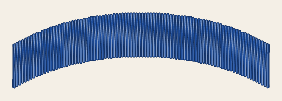
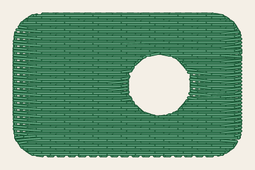
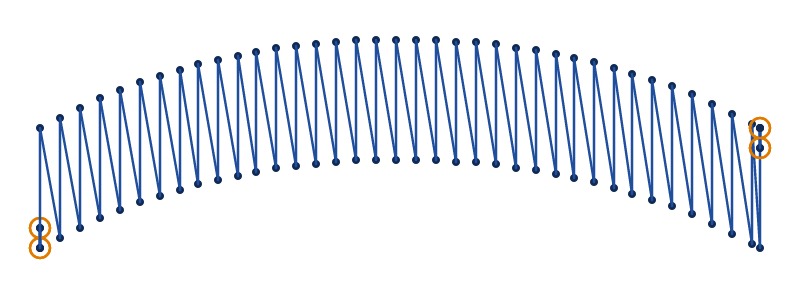
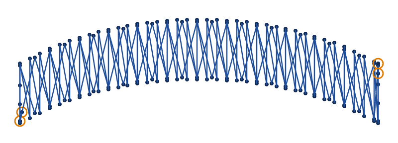

# Embroidery basics

Machine embroidery is drawing with thread under tension on fabric that moves. Almost every setting in
StitchCraft exists because of one of the effects below. Terms in **bold** are in the
[glossary](../reference/glossary.md).

## Stitches are straight lines between holes

The machine moves the hoop and drops the needle: each **stitch** is a straight segment between two
needle penetrations. A curve is a chain of short stitches. The shorter they are, the smoother the curve,
but the more holes the fabric takes. Too short (under about 0.3 to 0.5 mm) and the needle hits the same
hole, which shreds thread and fabric. Too long (beyond about 7 mm on exposed satin, 12 mm anywhere) and
stitches snag and sag.

## The main stitch families

Most designs sew in a few families of stitches. [Stitch types](../stitches/) shows every type
StitchCraft sews, each with its pictures.

- **Running stitch** is a dotted line of single stitches, for outlines, details and travel underneath.
  **Bean stitch** sews each stitch 3 or more times for a bold line.
- **Satin** stitches swing side to side between two edges. They make the glossy band seen in lettering and
  borders. It is good from about 1.5 mm to 8 or 10 mm wide.
- **Fill** is rows of running stitches covering an area. **Tatami** offsets the needle points from row to
  row so that no lines show.

<!-- shot: basics-satin -->
| Satin column |
|:-:|
|  |
<!-- /shot -->

<!-- shot: basics-fill -->

<!-- /shot -->

## The fabric fights back: pull and push

Thread under tension **pulls** the fabric together along the stitch direction. A satin column's stitches
cross it, and the column ends up narrower than drawn. A fill's rows come out shorter. The same stitches
**push** fabric outward across the stitch direction, so columns grow at their ends. **Pull compensation**
widens what is sewn so that the result matches what was drawn. How much it takes depends on the fabric,
the stabilizer, the density and the thread. Machine test sheet TS-07 measures it.

## Underlay: the foundation

**Underlay** is a light layer sewn first. It tacks fabric to stabilizer and lifts the top stitches so
that they look full. It also stops the fabric's texture poking through. Satins use centre-walk, contour or zigzag
underlay, and fills use a sparse fill at a cross angle. A design digitized automatically sews one
**base layer** under all of it instead, an open fill sewn first in one thread
([automatic digitizing](../stitches/automatic.md)).

<!-- shot: basics-underlay -->
**Without underlay**

**With a zigzag underlay**

<!-- /shot -->

## Density

**Row spacing** (fills) and **zigzag spacing** (satins) set density. Denser covers better but stiffens
the fabric, adds stitches and time, and pulls more. Around 0.4 mm suits most 40 wt thread on woven
fabric. Small text and knits want other values.

## How thick thread lies

Where shapes overlap, thread lies on thread. StitchCraft measures that thickness in **fills**: one fill is
as much thread as a tatami fill lays at its default row spacing. A satin column sewn over a fill puts more
than one fill on that spot, and each layer more makes the needle push through more thread. Too much and it
deflects, shreds the thread or breaks. So automatic digitizing aims at a most, the **cap**, and warns
where a spot still sews thicker ([how thick it sews](../stitches/automatic.md#how-thick-it-sews)).

## Stabilizer and hooping

**Stabilizer** backs the fabric so that it does not distort. Tear-away suits stable wovens, and cut-away
suits knits and dense designs. Hoop the fabric drum-tight without stretching it. Most "the design is
wrong" problems on the machine are stabilizer or hooping problems. The test-sheet protocol keeps these
constant, so that a sew-out tests the design and not the setup.

## Jumps, trims and locks

Moving from one place to another without sewing is a **jump**, and cutting the thread is a **trim**.
Before a trim or colour change the thread is secured with a **lock stitch** (tie-off), and after it with
a tie-in, so that the thread doesn't come loose. Short moves are cheaper sewn as **travel** stitches hidden under later
stitching.

## Hoops and their fields

A hoop keeps the fabric drum-tight, and the machine sews only inside the hoop's field, which is smaller
than its frame. The reference Brother PE800's 5 × 7 in hoop sews at most 130 × 180 mm, and its 4 × 4 in
hoop 100 × 100 mm. The fabric is most stable near the centre, and large dense designs pull more. A design
sews best in the smallest hoop it fits. StitchCraft stops with an error at a design larger than the hoop
it plans for, and warns beyond a profile's comfort zone where the profile has one.
