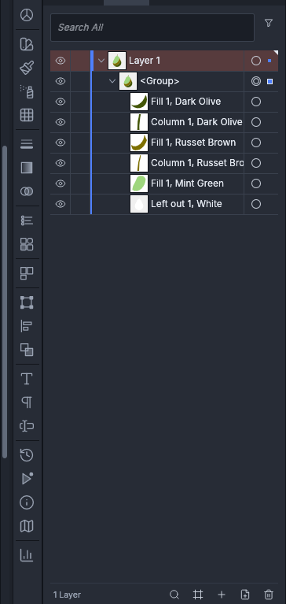

# Find a shape by its name

A traced photo has hundreds of shapes. To mark one, guide its rows or give it an effect of its own, you
first have to find it. Each shape of a design digitized automatically has a name, and the notices, the
report and VectorCraft's Layers panel all use it.

## The parts of a name

A name gives the shape's thread, how it sews, and its number among the shapes of that thread that sew
the same way:

- `Red fill (3)` is the third red area that sews as a fill.
- `Deep Gold column (1)` sews as satin columns, and `Black line (12)` as running stitches.
- `White left out (1)` sews nothing. It is the picture's background, or merged into the shapes beside it.

The thread is named as your machine names it. A colour that none of its threads has is named by its hex
code, such as `#7d6f00`. The number counts down the Layers panel from its top row, so it doesn't change
when the design sews in another order.

## In VectorCraft

`stitch plan picture.png --traced picture.vectorcraft` writes the names into the traced document. Open
it in VectorCraft, and the Layers panel shows each shape by its name. To find one, type its name into the
panel's search box. The number in brackets keeps `fill (1)` from finding `fill (12)`.

Open the group's row with its triangle to see the shapes' rows. Here is the traced pear in the panel, as
VectorCraft shows it at the panel's default width:

<!-- shot: vectorcraft-layers-names -->

<!-- /shot -->

The names are written once, when the picture is traced, and are then the shapes' own names, as a name
you give a shape is. StitchCraft never renames a shape that has a name. Rename any you like. A shape you
draw later has no name, and the notices name it for that plan only, with the next free number.

## In the notices

A notice about a shape names it before its id:

```text
info SC-I0912 ("Red fill (3)", vc:63:fill): This shape sews by the rule area.
```

The id, `vc:63:fill`, is what a bug report needs. The name is what you look for in the Layers panel.

## In the report

`stitch plan … --report report.json` gives each notice about a shape its `name`, and lists the shapes
under `shapes` in the order they sew. Each has its `name`, `element`, `thread`, `kind` and `place`, from
1. The shapes that sew nothing come last, with no place:

```json
"shapes": [
  { "name": "Red fill (1)", "element": "vc:6", "thread": "#ed171f", "kind": "fill", "place": 1 },
  { "name": "White left out (1)", "element": "vc:3", "thread": "#f0f0f0", "kind": "left out", "place": null }
]
```

The sewing order is chosen again at every plan, and one edit can move many shapes in it. The report gives
the order as this plan sews it.

## A path's own Auto effect in an automatic group

StitchCraft's Auto effect on a group makes everything in the group automatic with its settings. A path
inside it with an Auto effect of its own sews by its own settings alone. VectorCraft stores an effect with
every setting, so none of the group's reach the path. `SC-W0920` names the path and each of the group's
settings it doesn't take:

```text
warning SC-W0920 ("Red fill 2", vc:6): The object "Red fill 2" has StitchCraft's Auto effect of its own
inside a group with one, and sews by its own settings alone: it doesn't take the group's auto_overlap_mm
0.6 (its own: 1).
```

To sew the path by the group's settings, remove its own Auto effect. To keep it, set those settings on it
too.
