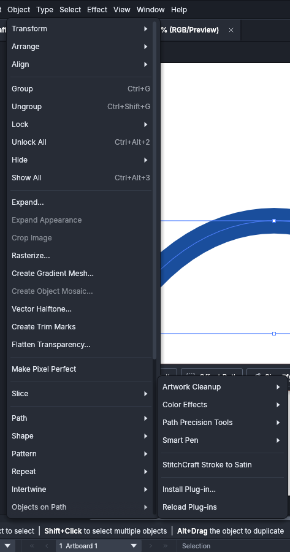

# Satin columns and presets in VectorCraft

The StitchCraft plug-ins add their effects to VectorCraft's Effect › Plug-ins menu, and VectorCraft's own
commands do the rest of what a design needs.

## Make a satin column VectorCraft can show

A satin column drawn as one path sews as wide as its stroke. From VectorCraft 0.14 StitchCraft Satin shows
its stitches as wide as the object's stroke. Before 0.14 VectorCraft gives an effect the path but not its
stroke, and StitchCraft Satin leaves such a path as it is and says why (`SC-I0810`). It does so too for an
object without a stroke of its own, such as a path a group's stroke paints. The file still sews it. To see
its stitches in VectorCraft then, draw the column with 2 rails:

1. Draw the column's 2 edges as 2 paths.
2. Select both and choose **Object › Compound Path › Make** (Cmd+8).
3. With the compound path selected, choose **Effect › Plug-ins › StitchCraft Satin**, and set the column
   up in its dialog ([the whole dialog](../tutorials/vectorcraft-patch.md#3-draw-the-border)).

VectorCraft then shows the column's stitches between its rails:

<!-- shot: vectorcraft-satin-rails -->

<!-- /shot -->

Apply the effect after joining the rails. VectorCraft 0.10.0 and later keep the appearance of the path at
the back, and earlier versions that of the path in front, which may not be the one with the effect. From
0.10.0, VectorCraft may also reverse the front path, and always does for 2 straight rails. The column
turns it back (`reverse_rails`, automatic). A reversed ring also starts somewhere else, so of 2 rings the
second starts at its node nearest the first's start. The stitches are the same whatever node the rails
were drawn from and whichever way they run.

## Add a rung

Rungs set the angle of the stitches along the column. With the Pen tool, add a line across both rails
where the stitches should run. Select it with the column, and choose **Object › Compound Path › Make**.
From VectorCraft 0.10.0 the column, behind the line, keeps its effect. Before 0.10.0 the compound path takes
the line's appearance: apply StitchCraft Satin to it again.

## Make a line into a satin column

From VectorCraft 0.17, **Object › Plug-ins › StitchCraft Stroke to Satin** makes each selected line into
a satin column drawn with its 2 rails and rungs, as Ink/Stitch's Stroke to Satin does. The line is the
column's centre line, and its stroke gives the column's width: the topmost stroke that paints, as
StitchCraft Satin follows. The rails and rungs are those StitchCraft makes of a satin column drawn as one
path when it sews it. So the column sews as the line did with the satin effect, and its rails and rungs
can then be edited.

1. Give each line a stroke as wide as the column.
2. Select the lines, and choose **Object › Plug-ins › StitchCraft Stroke to Satin**.

<!-- shot: vectorcraft-stroke-to-satin-menu -->

<!-- /shot -->

Each line becomes a compound path of its rails and rungs, without a fill, its stroke the line's colour,
one pixel wide. It has StitchCraft Satin with the line's satin settings, or the defaults, in the place of
the line's StitchCraft effects, and keeps the line's other effects. A path of several lines makes a
column of each. A satin column already drawn with rails is left as it is. When a line can't be made into a
column, nothing changes, and VectorCraft says why (`SC-E0814`), for a path without a stroke, or a line
whose column would sew less than the line: one too short or tight for its width, or one that crosses
itself. A line whose satin effect lengthens both its ends, with a push compensation below 0 at each, can
be refused too, when its column needs a rung across one end to tell its rails from its rungs: that rung
would sew the end's extra length apart. Set the push compensation to 0 or more at one end first.

Making the rails of a curved line takes more work than a filter usually may do. So Stroke to Satin asks
for more when it is installed, and VectorCraft asks you first, then runs it in the background with
**Cancel**. StitchCraft Satin must be installed too. VectorCraft 0.15 and 0.16 run it with the time any
filter gets, and stop it on most curved lines. Before 0.15 it asks for a newer VectorCraft (`SC-E0813`).

## Keep settings as a preset

A graphic style keeps an appearance, StitchCraft's effects included:

1. Select an object whose StitchCraft effect is set as you like it.
2. Choose **Window › Graphic Styles › New Graphic Style**.
3. Select other objects and click the style in the Graphic Styles panel.

Each object gets a copy of the effect, with the style's parameters, and sews with them. A style applied
to a group or a layer puts its effects on the group, and every path inside it sews with them. The style's
fills and strokes go on the group too, and VectorCraft paints them over the group's contents. Each path
inside sews in the colour on top, the style's fill for a fill effect and the style's stroke for a satin
column, which follows its width. Where the style has no paint of that kind, or lets the path show through
it, the path's own paint of that kind gives the colour, and with none on either, the topmost paint of the
other kind does. A path without paint under a style without any is invisible and isn't sewn. To show the
paths' own colours over the style's, drag the Contents row above the style's fills and strokes in the
Appearance panel. Keep StitchCraft's effects at one level, though. A path that has its own StitchCraft
effect inside such a group, or sits inside 2 such groups, is drawn as one effect run on the stitches of
the other. It sews as the nearest effect says, and the command line warns about it (`SC-W0807`).
Alt-clicking a style adds its effects to the object's own, and an object with 2 fill effects sews twice.

Give each StitchCraft effect an object of its own. An object with 2 sews each on its shape, but
VectorCraft draws the second on the stitches of the first, so the preview isn't what is sewn, and the
command line warns about it (`SC-W0807`). For a fill with an outline, copy the shape, choose **Edit ›
Paste in Front**, and give the shape behind a fill effect and the copy in front a stroke effect.

## Turn a preview into paths

**Object › Expand Appearance** turns what an effect shows into ordinary objects, with strokes outlined.
Those objects are the shapes the preview draws, and they sew differently from the effect. Expand a copy
for a picture of the stitches, and keep the original to sew.

## Draw a test sheet

[Embroider a VectorCraft design](embroider-a-vectorcraft-design.md#draw-a-test-sheet) shows how to draw a
test sheet into a document from VectorCraft 0.16, and [`stitch testsheet`](../reference/test-sheets.md)
writes every sheet.
