<!-- Generated by `cargo xtask docs` from `stitchcraft-engine/src/testsheets/` and the `stitch` shots in `docs/shots.toml`. Edit the source, not this page. -->

# Test sheets

Designs drawn in code for the [machine checkpoints](../../plan/machine-testing.md), each for one hoop of the reference machine. Write one with `stitch testsheet <id> -o <id>.pes`. The command checks it against the profile of that hoop, or the one `--profile` names, and prints what to check after sewing it, as listed here. The pictures are previews: they show what the machine will sew, including jump threads it leaves for you to cut. In VectorCraft, the Test Sheet filter draws the sheets that say so into a document ([how](../how-to/embroider-a-vectorcraft-design.md#draw-a-test-sheet)).

## TS-01 — Orientation and scale

120.0 × 120.0 mm · 274 stitches, 7 jumps, 6 trims, 0 colour changes, 0 stops · trims: the machine makes none of them: cut the jump threads by hand

Hoop: the Brother PE800 with its 5 × 7 in hoop, profile [`brother-pe800-5x7`](profiles.md#brother-pe800-5x7).

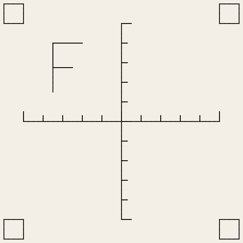

Threads: Black.

After sewing, check:

- The F reads normally: not mirrored, not upside down, not turned.
- Each arm of the cross measures 100.0 ± 0.5 mm end to end, horizontally and vertically.
- The corner squares measure 10.0 mm on every side.
- Ticks are 10 mm apart; the long ticks mark the ends and the centre.

## TS-02 — Colour changes, a stop, jumps and trims

120.0 × 70.0 mm · 93 stitches, 17 jumps, 16 trims, 2 colour changes, 1 stop · trims: the machine makes none of them: cut the jump threads by hand

Hoop: the Brother PE800 with its 5 × 7 in hoop, profile [`brother-pe800-5x7`](profiles.md#brother-pe800-5x7).

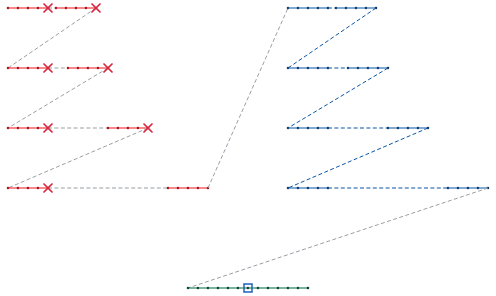

Threads: Red, Blue, Emerald Green, Emerald Green (stop).

After sewing, check:

- The machine stops for red → blue and blue → green, and once more in the middle of the green line (the stop).
- Left half (red, a trim before every jump): for each row (gaps of 2, 5, 15, 30 mm, top to bottom), was the thread between the two dashes cut?
- Right half (blue, jumps without trims, which a PES file flags as trims too): did every dash sew? For each row, and between rows, was the thread cut?
- Any loose loops, knots or bird's nests on the back, and where.

## TS-02B — TS-02 drawn as a design: trims elements ask for

120.0 × 70.0 mm · 230 stitches, 17 jumps, 16 trims, 2 colour changes, 1 stop · trims: the machine makes none of them: cut the jump threads by hand

Hoop: the Brother PE800 with its 5 × 7 in hoop, profile [`brother-pe800-5x7`](profiles.md#brother-pe800-5x7).

Drawn as a design, which VectorCraft's Test Sheet filter draws too.

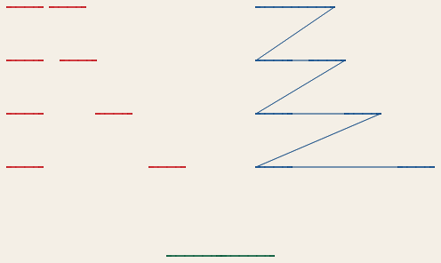

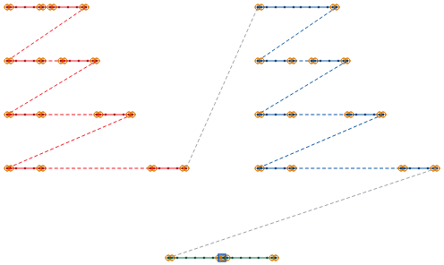

Threads: Red, Blue, Emerald Green, Emerald Green (stop).

After sewing, check:

- The machine stops for red → blue and blue → green, and once more in the middle of the green line (the stop), and cuts the thread at each.
- Left half (red; every dash but the last asks for a trim after it): the machine cuts no jump, so its rows (gaps of 2, 5, 15, 30 mm, top to bottom) are joined by threads. Did every dash stay sewn while the machine went on to the next?
- Right half (blue; no trims): the 2 mm gap is sewn across, and threads join the other dashes and the rows. Did every dash stay sewn?
- Each dash starts and ends with a small lock. Snip the threads between the dashes, then pull each tail gently: does the dash hold?
- Any loose loops, knots or bird's nests on the back, and where.

## TS-03 — Running stitch: lengths, bean stitch, curves, the shortest stitch

60.0 × 78.0 mm · 588 stitches, 15 jumps, 14 trims, 0 colour changes, 0 stops · trims: the machine makes none of them: cut the jump threads by hand

Hoop: the Brother PE800 with its 5 × 7 in hoop, profile [`brother-pe800-5x7`](profiles.md#brother-pe800-5x7).

Drawn as a design, which VectorCraft's Test Sheet filter draws too.

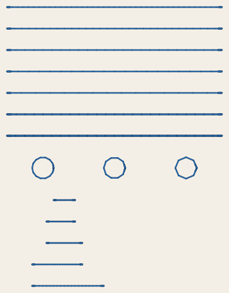

Threads: Blue.

After sewing, check:

- Running stitch lines (top five; 1.5, 2.0, 2.5, 3.0 and 4.0 mm): the stitches of each line are even; ten stitches, counted inside the small lock at each end, measure 15, 20, 25, 30 and 40 mm.
- Bean stitch lines (next two; each stitch sewn three and five times): solid and raised, with no gaps.
- Circles (6 mm across; tolerance 0.1, 0.2 and 0.5 mm, left to right): round, with fewer and straighter stitches to the right.
- Short stitches placed by hand (bottom five; 0.3, 0.4, 0.5, 0.7 and 1.0 mm, each with a small back-and-forth lock at both ends): which lines sew cleanly, with no thread breaks, knots or bunching on the back? The shortest clean one is the machine's shortest stitch; if the 0.3 mm line is clean, it is 0.3 mm or less: the sheet has no shorter line.

## TS-04 — Lock stitches: do they hold, and do they show?

110.0 × 64.6 mm · 623 stitches, 27 jumps, 26 trims, 0 colour changes, 0 stops · trims: the machine makes none of them: cut the jump threads by hand

Hoop: the Brother PE800 with its 5 × 7 in hoop, profile [`brother-pe800-5x7`](profiles.md#brother-pe800-5x7).

Drawn as a design, which VectorCraft's Test Sheet filter draws too.

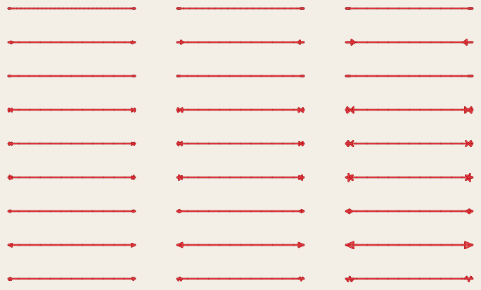

Threads: Red.

After sewing, check:

- Rows, top to bottom: half stitch, arrow, back and forth, bowtie, cross, star, simple, triangle, zigzag. Each line has its lock at both ends and was trimmed after, but the machine cuts no jump: snip the threads between the lines, then pull each tail gently. Does the lock hold, or does the line come undone?
- Columns, left to right, are small, medium and large: the half stitch on first stitches of 1, 1.5 and 2.5 mm, back and forth at 0.5, 0.7 and 1.0 mm, the others at 70, 100 and 150 %.
- Rows 1, 3, 5, 7 and 9 are sewn left to right and the others right to left: a line's start is the end it was sewn from.
- Which locks show from the front, and how much (1 hidden to 5 obvious)?
- Any thread breaks or knots at the locks, and where.

## TS-05 — Satin width ladder: spacing, width and pull

91.0 × 76.0 mm · 3440 stitches, 30 jumps, 29 trims, 0 colour changes, 0 stops · trims: the machine makes none of them: cut the jump threads by hand

Hoop: the Brother PE800 with its 5 × 7 in hoop, profile [`brother-pe800-5x7`](profiles.md#brother-pe800-5x7).

Drawn as a design, which VectorCraft's Test Sheet filter draws too.

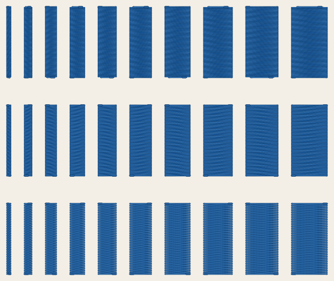

Threads: Blue.

After sewing, check:

- Rows, top to bottom, are at zigzag spacings of 0.3, 0.4 and 0.5 mm, and the columns of each row are 1 to 10 mm wide, left to right.
- Coverage: in which columns does the fabric show between the stitches? Rate each row 1 (bare) to 5 (solid).
- Width: measure the 2, 6 and 10 mm columns of each row across, halfway down. How much narrower than drawn are they?
- Edges: straight and crisp, or wavy? From which width on do the long stitches lie loose or catch?
- Any puckering round the columns, thread breaks, or loops on the back, and where.

## TS-06 — Satin underlays side by side

62.0 × 30.0 mm · 966 stitches, 5 jumps, 4 trims, 0 colour changes, 0 stops · trims: the machine makes none of them: cut the jump threads by hand

Hoop: the Brother PE800 with its 5 × 7 in hoop, profile [`brother-pe800-5x7`](profiles.md#brother-pe800-5x7).

Drawn as a design, which VectorCraft's Test Sheet filter draws too.

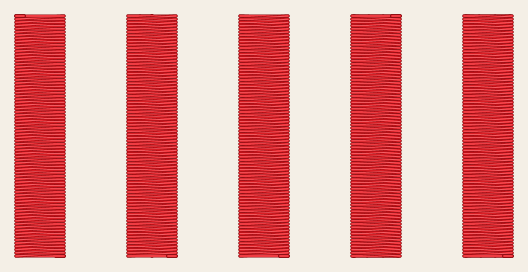

Threads: Red.

After sewing, check:

- Columns, left to right: no underlay, a centre walk, a contour, a zigzag, and a contour with a zigzag, each 6 mm wide.
- Edges: rate each column 1 (ragged) to 5 (crisp).
- Loft: rate each column 1 (flat) to 5 (full and raised).
- Does any underlay show past the top stitches, at the edges or at the ends?
- Measure each column across, halfway down, and note any puckering round it.

## TS-07 — Fill and outline registration at 3 pull compensations

126.2 × 126.0 mm · 13527 stitches, 6 jumps, 5 trims, 1 colour change, 0 stops · trims: the machine makes none of them: cut the jump threads by hand

Hoop: the Brother PE800 with its 5 × 7 in hoop, profile [`brother-pe800-5x7`](profiles.md#brother-pe800-5x7).

Drawn as a design, which VectorCraft's Test Sheet filter draws too.

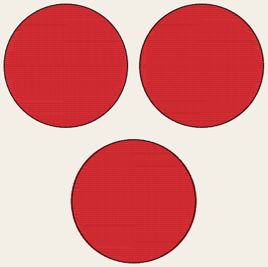

Threads: Red, Black.

After sewing, check:

- Circles: top left with no pull compensation, top right with 0.2 mm, bottom with 0.4 mm. Each red fill is 60 mm across, with a black running stitch along its edge.
- At 12 points round each circle, as the hours of a clock: does fabric show between the fill and the outline, or does the fill reach past it? Measure the largest gap and the largest overlap of each circle.
- Measure each fill across, left to right and top to bottom. How much less than 60 mm is it, and how much of that does the compensation make up?
- Any puckering round the circles, and where.

## TS-08 — Fill density and angle

100.0 × 170.0 mm · 16248 stitches, 15 jumps, 14 trims, 0 colour changes, 0 stops · trims: the machine makes none of them: cut the jump threads by hand

Hoop: the Brother PE800 with its 5 × 7 in hoop, profile [`brother-pe800-5x7`](profiles.md#brother-pe800-5x7).

Drawn as a design, which VectorCraft's Test Sheet filter draws too.

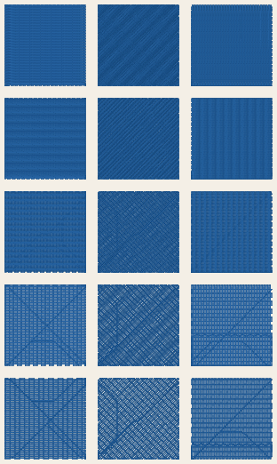

Threads: Blue.

After sewing, check:

- Rows, top to bottom, are at row spacings of 0.25, 0.3, 0.4, 0.5 and 0.6 mm, and the columns at angles of 0°, 45° and 90°, left to right. Each square is 30 mm wide.
- Coverage: in which squares does the fabric show between the rows? Rate each row of squares 1 (bare) to 5 (solid).
- At 0.25 mm the rows lie nearer each other than the machine's shortest stitch of 0.3 mm. In the 0° and 90° squares, whose edges meet the rows square on, each row's first needle point is left out: does a sliver of fabric show at the rows' starts, along those edges? The 45° square's rows end 0.35 mm apart along its edges and keep their starts.
- Stiffness: rate each row of squares 1 (soft) to 5 (stiff as card). Is there puckering round any square, or furrows where needle points line up?
- Measure the 0° and the 90° square at 0.4 mm across, both ways. How much less than 30 mm are they?

## TS-09 — Fill underlay, travel and gap-filling rows round holes

66.0 × 114.0 mm · 7780 stitches, 6 jumps, 5 trims, 0 colour changes, 0 stops · trims: the machine makes none of them: cut the jump threads by hand

Hoop: the Brother PE800 with its 5 × 7 in hoop, profile [`brother-pe800-5x7`](profiles.md#brother-pe800-5x7).

Drawn as a design, which VectorCraft's Test Sheet filter draws too.

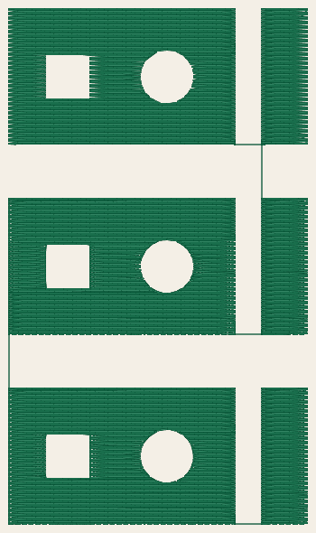

Threads: Emerald Green.

After sewing, check:

- Top to bottom: without underlay, with Ink/Stitch's default underlay, and with the underlay and 2 gap-filling rows. Each is a 50 × 30 mm rectangle with a square hole and a round hole, and a bar 6 mm to its right that belongs to the same fill.
- Travel: does any running stitch between rows show on top of the fill? Where?
- The bar: was the thread to it cut, or does a jump thread run to it? Does the fill hold at both ends of that jump?
- Holes: are their edges clean, with no row across them and no fabric showing round them?
- Where the rows round a hole meet again, does a gap open along a row? Does the bottom copy, with gap-filling rows, close it?
- How the 3 copies differ in stiffness, and any puckering.

## TS-10A — Hoop size: the 4 × 4 in hoop, a 100 × 100 mm frame

100.0 × 100.0 mm · 195 stitches, 4 jumps, 3 trims, 0 colour changes, 0 stops · trims: the machine makes none of them: cut the jump threads by hand

Hoop: the Brother PE800 with its 4 × 4 in hoop, profile [`brother-pe800-4x4`](profiles.md#brother-pe800-4x4).

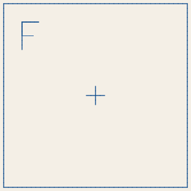

Threads: Blue.

After sewing, check:

- With the 4 × 4 in hoop on the machine: does the machine take the file and sew it, without asking for a larger hoop?
- The frame measures 100.0 × 100.0 mm (± 0.5 mm), the F at the top left.

## TS-10B — Hoop size: the 5 × 7 in hoop, a 130 × 180 mm frame

130.0 × 180.0 mm · 283 stitches, 4 jumps, 3 trims, 0 colour changes, 0 stops · trims: the machine makes none of them: cut the jump threads by hand

Hoop: the Brother PE800 with its 5 × 7 in hoop, profile [`brother-pe800-5x7`](profiles.md#brother-pe800-5x7).

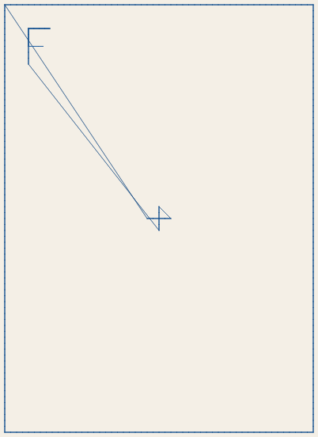

Threads: Blue.

After sewing, check:

- With the 5 × 7 in hoop on the machine: does the machine take the file and sew it?
- The frame measures 130.0 × 180.0 mm (± 0.5 mm), tall side top to bottom, the F at the top left.

## TS-10C — Hoop size: the small hoop, a 20 × 60 mm frame

20.0 × 60.0 mm · 92 stitches, 4 jumps, 3 trims, 0 colour changes, 0 stops · trims: the machine makes none of them: cut the jump threads by hand

Hoop: the Brother PE800 with its small hoop, profile [`brother-pe800-small`](profiles.md#brother-pe800-small).

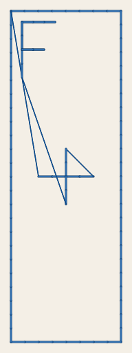

Threads: Blue.

After sewing, check:

- With the small hoop on the machine: does the machine take the file and sew it, without asking for a larger hoop?
- If it asks for a larger hoop, turn the design a quarter turn on the machine's screen. Does it take it then?
- The frame measures 20.0 × 60.0 mm (± 0.5 mm), tall side top to bottom, the F at the top left.

## TS-13A — Pictures digitized automatically: neighbours and sewing order

126.0 × 168.0 mm · 24286 stitches, 31 jumps, 30 trims, 20 colour changes, 1 stop · trims: the machine makes none of them: cut the jump threads by hand

Hoop: the Brother PE800 with its 5 × 7 in hoop, profile [`brother-pe800-5x7`](profiles.md#brother-pe800-5x7).

Drawn as a design whose shapes StitchCraft digitizes automatically, as `--auto` does a shape without settings. VectorCraft's Test Sheet filter draws it too, those shapes with the Auto effect.

Threads: Red, Blue, Deep Gold, Red, Blue, Deep Gold, Blue, Red, Blue, Deep Gold, Red, Blue, Deep Gold, Red, Blue, Deep Gold, Blue, Blue (stop), Red, Deep Gold, Blue, Deep Gold.

After sewing, check:

- The top half is digitized automatically, and the bottom half is the same shapes sewn as drawn, in paint order. The bottom half sews first, and the machine stops between them. Top row, left to right: a badge traced abutting and one traced stacked, each 40 mm across, and a blue disc with 7 red specks round it. Bottom row: 3 badges drawn badge by badge, and a gold square with a blue bar beside it.
- The bottom half changes thread 16 times and jumps 15 times, the top half 4 and 16 times. How long does each half take?
- Does fabric show between colours, on either half? On the top half, each area reaches 0.4 mm under the next: does that cover the gap, or show as a ridge?
- On the top half, the stacked badge's lower colours are cut away under the upper ones. Does it sew as flat as the abutting badge beside it? On the bottom half, it sews its lower colours whole, under the upper ones.
- On the bottom half, each speck round the disc sews a red knot. On the top half, the 6 specks that touch the disc are blue, part of it, and the one apart is left out. Does the disc's edge show where they were?
- The blue bar meets the gold square along the top half of its side, and runs on 0.5 mm from it below. On the top half, the bar, sewn first, reaches under the square only where they meet. Does the fabric that shows below read as a gap drawn there?
- Does any shape cover one drawn over it? The order must never let that happen.
- The machine cuts the thread at thread changes and at the stop, but at no jump, and the pictures sew as any design does: a shape sewn after a jump may sew its thread down. Snip the jump threads at each stop and after sewing. Where is one sewn down, and does it show?

## TS-13B — Pictures digitized automatically: letters and lines traced as areas

110.4 × 148.4 mm · 14401 stitches, 57 jumps, 56 trims, 16 colour changes, 1 stop · trims: the machine makes none of them: cut the jump threads by hand

Hoop: the Brother PE800 with its 5 × 7 in hoop, profile [`brother-pe800-5x7`](profiles.md#brother-pe800-5x7).

Drawn as a design whose shapes StitchCraft digitizes automatically, as `--auto` does a shape without settings. VectorCraft's Test Sheet filter draws it too, those shapes with the Auto effect.

Threads: Black, Red, Blue, Deep Gold, Black, Red, Blue, Deep Gold, Black, Red, Blue, Deep Gold, Black, Black (stop), Red, Blue, Deep Gold, Black.

After sewing, check:

- The top half is digitized automatically, and the bottom half is the same shapes sewn as drawn, in paint order. The bottom half sews first, and the machine stops between them. Left: the word MATCH in block letters 15, 10, 6 and 4 mm tall, top to bottom, each letter traced as an area. Right: 3 windows, top to bottom, whose black lines, traced as areas, are 0.3, 0.6 and 0.9 mm wide. One line runs down each window, and a branch runs across to its right side from it.
- The bottom half changes thread 12 times and jumps 16 times, the top half 4 and 41 times. A letter filled sews in one piece, and digitized it is columns and lines with jumps between them. How long does each half take?
- Which is the smallest word that reads, on each half?
- On the top half, the letters from 6 mm tall sew as satin columns between their own edges, and the 4 mm ones as triple runs along their middles. Do the columns' stitches lie square to their strokes, round the C's bend and the A's hole?
- Where a column ends under another, 0.4 mm longer, as the T's stem does under its bar, does fabric show there, or a ridge? Does a crossbar sewn as a column of its own, as the H's is, read as one stroke with its stems? The M's and the A's feet should end flat along the baseline, and the C's ends round.
- Do the underlays hold the columns up? With 0.4 mm of pull compensation, do they sew as wide as drawn? Measure the 15 mm T's stem, drawn 2.7 mm wide.
- Where the M's strokes meet at sharp angles, its stitches lean along the columns (SC-W0208). Do they show?
- On the top half, each window's lines sew along their middles after the areas beside them, which reach 0.4 mm under them: a single run at 0.3 mm, and a triple run at 0.6 and 0.9 mm. Does each line reach as far as it is drawn? Do the triple runs look as wide as their lines, and the single run not too thin? Does fabric show along a line, or a gap or a knot where the branch ends at the line it meets?
- The machine cuts the thread at thread changes and at the stop, but at no jump, and the pictures sew as any design does: a shape sewn after a jump may sew its thread down. Snip the jump threads at each stop and after sewing. Where is one sewn down, and does it show?

## TS-13C — Pictures digitized automatically: lines, and shapes in parts

111.4 × 107.8 mm · 10311 stitches, 25 jumps, 24 trims, 8 colour changes, 1 stop · trims: the machine makes none of them: cut the jump threads by hand

Hoop: the Brother PE800 with its 5 × 7 in hoop, profile [`brother-pe800-5x7`](profiles.md#brother-pe800-5x7).

Drawn as a design whose shapes StitchCraft digitizes automatically, as `--auto` does a shape without settings. VectorCraft's Test Sheet filter draws it too, those shapes with the Auto effect.

Threads: Flesh Pink, White, Black, Deep Gold, Red, Red (stop), Flesh Pink, White, Black, Deep Gold.

After sewing, check:

- The top half is digitized automatically, and the bottom half is the same shapes sewn as drawn, in paint order. The bottom half sews first, and the machine stops between them. Left to right: a face drawn with black lines, a star, and a balloon on its string.
- The bottom half changes thread 4 times and jumps 14 times, the top half 4 and 11 times. How long does each half take?
- The face's outline is 4 mm wide, its eyes' 2 mm and its brows' 1 mm. On the top half, the outlines sew as satin columns and the brows as triple runs. Do the columns cover the edges of the pink and white areas beside them? Do the triple runs look as wide as the brows are drawn?
- The smile is 2 mm wide with round caps, and on the top half its column ends square, 1 mm past each end of its line, where the round cap ends. How far does its corner show past the round end?
- The pupils are small rings, and the 3 hairs hairpins, which turn more tightly than they are wide: the top half fills them. How solid do they sew beside the columns round them?
- On the top half, the star's points and the balloon's string sew as satin columns over the fill of the star's middle and of the balloon, cut square where they meet it. Does each column's flat end cover the fill's edge, or does fabric or a ridge show there? Do each point's stitches lie square to it from its tip to its cut?
- Does each line sewn after the area it borders cover the area's edge? Does any shape cover one drawn over it?
- The machine cuts the thread at thread changes and at the stop, but at no jump, and the pictures sew as any design does: a shape sewn after a jump may sew its thread down. Snip the jump threads at each stop and after sewing. Where is one sewn down, and does it show?
