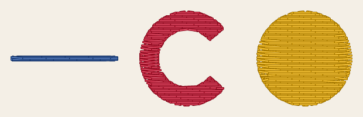
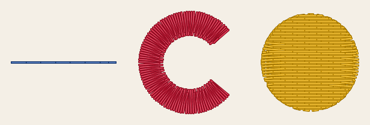
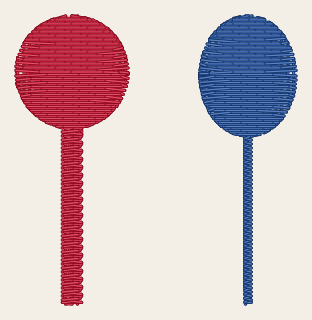
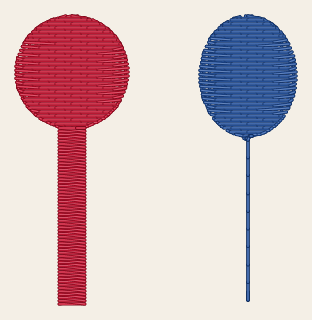
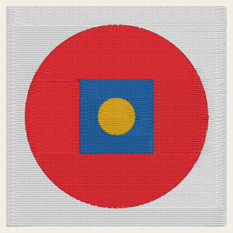
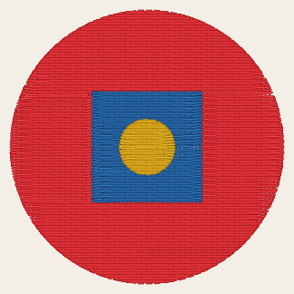

# Automatic digitizing

StitchCraft can choose a shape's stitches itself. A shape without settings sews by its width, at the size
it sews ([stitches by width](#stitches-by-width)). Digitizing also mends where shapes meet, and chooses an
order with few thread changes. A picture traced in VectorCraft then becomes a machine file without a
setting on any shape.

To digitize the shapes without settings:

- on the command line, add `--auto` to [`stitch plan`](../reference/cli.md) or `stitch export`, or give
  `stitch plan` a picture, which it traces first
  ([from a picture to a machine file](../tutorials/picture-to-machine-file.md));
- in VectorCraft, give the shapes StitchCraft's Auto effect, whose dialog sets the rules' settings.

A shape with settings sews as they say. Each picture below shows shapes sewn as drawn, as a design sews
without `--auto`, and then digitized automatically.
[Image to embroidery](../../design/image-to-embroidery.md) gives every rule in full.

## Stitches by width

A shape's width at a place is the diameter of the largest circle that fits inside it there:

| Width | Sewn as |
|---|---|
| Up to the design's narrowest satin stroke, `min_satin_stroke_width_mm`, 1 mm unless the design sets it | A running stitch along the middle, tripled from 0.5 mm wide (`auto_min_triple_run_width_mm`) |
| Wider, up to the widest satin column, 7 mm (`auto_max_satin_width_mm`) | Satin columns between the shape's own edges |
| Wider | A tatami fill |

A stroke is a line as wide as it is drawn, and its width chooses its stitches the same way: one as wide
as a satin column sews as a [satin column drawn as one path](satin-column.md#drawn-as-one-path). The
pictures are drawn from `docs/fixtures/widths.svg`, a line 0.6 mm wide, a letter C 3 mm wide and a disc
16 mm across, each traced as an area.

**As drawn**

<!-- shot: auto-widths-drawn -->

<!-- /shot -->

**Digitized**

<!-- shot: auto-widths -->

<!-- /shot -->

## Shapes in parts

A shape can be broad in one place and narrow in another, such as a letter with thin serifs or a balloon
on a string. Its broad parts are filled, and its narrow parts sew as columns and lines that reach into
the fill. The pictures are drawn from `docs/fixtures/parts.svg`, a lollipop on a stick 2.4 mm wide and a
balloon on a string 0.8 mm wide, each one area.

**As drawn**

<!-- shot: auto-parts-drawn -->

<!-- /shot -->

**Digitized**

<!-- shot: auto-parts -->

<!-- /shot -->

## Neighbours

The shapes of a traced picture meet, and sewn as drawn they sew badly there. Digitizing mends that in 3
steps:

1. **The background.** The lowest shape, when it covers the whole picture with the other shapes drawn
   on it, is the background, the fabric's own colour, and is left out (`SC-W0906`, and
   `auto_ignore_background` to keep it).
2. **Specks.** A shape or a part of one smaller than 1 mm² would sew a knot. It is merged into the shape
   it shares the longest edge with (`SC-I0905`, `auto_min_area_mm2`).
3. **Overlaps.** The thread pulls stitches in from the edges of their shape, so shapes that only meet show
   fabric between them once sewn. Each area reaches 0.4 mm under the shapes sewn after it that it
   touches (`SC-I0904`, `auto_overlap_mm`). An area stacked under another is cut away under it, so that
   each place sews once.

The pictures are drawn from `docs/fixtures/traced-badge.svg`, a badge traced on white: as drawn, the white
is sewn too.

**As drawn**

<!-- shot: traced-badge-drawn -->

<!-- /shot -->

**Digitized**

<!-- shot: auto-badge -->

<!-- /shot -->

## Sewing order

The shapes sew in an order StitchCraft chooses. 4 rules decide it, each where the rules before it leave a
choice:

1. Of 2 shapes that overlap, the lower sews first, as drawn.
2. A column or a line sews after a fill it borders, and covers its edge.
3. The thread stays the same as long as a shape of that thread may sew next. The machine then changes
   thread as seldom as it can.
4. Of those shapes, the nearest sews next.

## Settings by width

Each satin column digitizing makes has the underlay of its width, and 0.4 mm of pull compensation:

| Column width | Underlay |
|---|---|
| Below 2 mm | Centre walk |
| 2 to 4 mm | Contour |
| Above 4 mm | Contour and zigzag |

Fills keep a tatami fill's defaults, their underlay included. These are starting values, which the next
sew-out at the machine checkpoint confirms or changes.

## Settings

Each rule goes by the settings of the shape it digitizes, and a shape that sets none takes the defaults,
as every shape does with `--auto`. VectorCraft's Auto effect sets them, and the
[reference](../reference/params/auto.md) gives each one's range and default. The narrowest satin column
is the design's `min_satin_stroke_width_mm`, and the underlay of a column's width is no setting.
