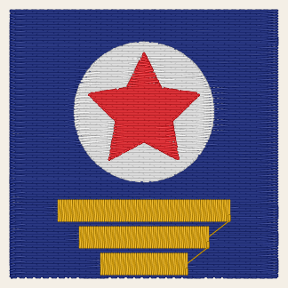
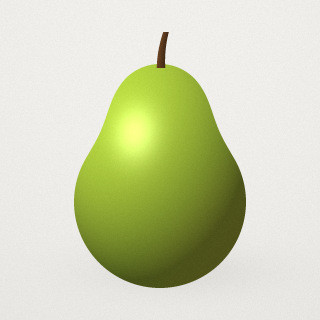
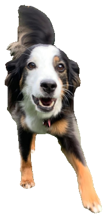
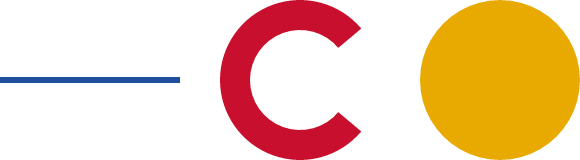
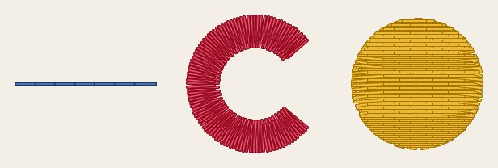
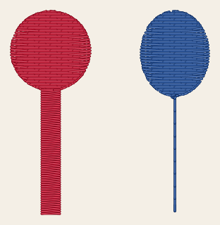
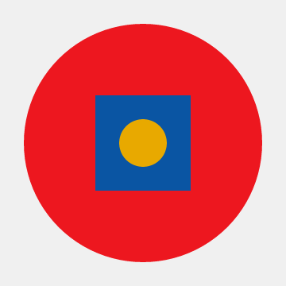
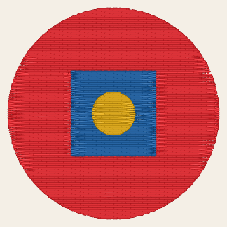

# Automatic digitizing

Automatic digitizing makes a machine file from a picture without a setting on any of its shapes. StitchCraft
chooses the stitches of each shape by its width and mends the places where shapes meet. It also orders the
sewing for few colour changes. It is made for 2 kinds of picture:

- [Flat-colour art](#flat-colour-art), such as logos, badges, clip art and drawings. Its colours are solid
  shapes, stacked in layers or abutting.
- [A photo reduced to a few flat colours](#a-photo-in-a-few-colours), such as 4. It sews in those flat
  colours, as flat-colour art does.

## Flat-colour art

Logos, badges, clip art and drawings have a few flat colours, each of them one solid shape or more. The
emblem below, `docs/fixtures/emblem.svg`, is drawn in layers in 4 of the machine's threads, each layer whole
under the layers drawn over it.

**The picture**

<!-- shot: auto-emblem-picture -->

<!-- /shot -->

**Digitized**

<!-- shot: auto-emblem -->

<!-- /shot -->

The navy square and the white disc are broader than a satin column, and each is filled whole under the
shapes on it. The bars are 3 mm tall and sew as satin columns. The white round the square is the picture's
background, the fabric's own colour, and is left out.

To digitize such art:

- Art drawn in VectorCraft, or opened there from an SVG file, is made of shapes already. Select them,
  choose **Effect › Plug-ins › StitchCraft Auto**, and write the machine file
  ([how](../how-to/embroider-a-vectorcraft-design.md#write-the-machine-file)). On the command line, add
  `--auto` to [`stitch plan`](../reference/cli.md#stitch-plan) or `stitch export`, as in
  `stitch plan emblem.svg --auto -o emblem.pes`.
- A picture of the art, a PNG or JPEG file, is traced into shapes first, in the machine's threads.
  `stitch plan emblem.png -o emblem.pes` traces it with VectorCraft's command line, then digitizes the shapes.
  In VectorCraft, Image Trace traces it
  ([from a picture to a machine file](../tutorials/picture-to-machine-file.md)).

## A photo in a few colours

A photo's colours blend into each other. VectorCraft's Image Trace reduces them to a few flat colours first,
such as 4 of the machine's threads, the backdrop's colour among them. The traced shapes are then digitized as
flat-colour art is. The photo sews in those few flat colours, and its blended shading isn't reproduced.
[Image to embroidery](../../design/image-to-embroidery.md) leaves photos sewn in blended colours outside the
roadmap.

**The photo**

<!-- shot: auto-pear-photo -->

<!-- /shot -->

**Traced in 4 threads**

<!-- shot: auto-pear-traced -->

<!-- /shot -->

**Digitized**

<!-- shot: auto-pear -->

<!-- /shot -->

The photo is drawn in code for these pages. `stitch plan` traced it 90 mm across with VectorCraft 0.19.0, into
`docs/fixtures/traced-pear.vectorcraft`. The pear's shading became 3 bands of green, and the backdrop the
4th colour, which is left out as the picture's background. The thread of each darker band sews a side of
the stem too, between the band's 2 ends. The thin straight lines are the jumps to the stem and back, which
the reference machine leaves for you to cut by hand ([machine profiles](../reference/profiles.md)).

To digitize a photo:

- `stitch plan pear.png --colours 4 --size 90 -o pear.pes` traces the photo in 4 threads, 90 mm across, and
  digitizes the shapes. `--colours` counts the backdrop's colour too.
- In VectorCraft, trace it with Image Trace's **Colors** set to 4, then give the traced shapes StitchCraft's
  Auto effect
  ([from a picture to a machine file](../tutorials/picture-to-machine-file.md#2-trace-the-picture-in-those-threads)).

## A photo with its background removed

A photo's background, such as the turf a dog stands on, traces into shapes of its own, which sew too. To sew
the subject alone, remove the background first, in any program that makes it transparent, and save the
photo as a PNG file. Image Trace leaves transparent pixels out, so the photo traces into its subject's shapes
alone ([pictures from the command line](../../design/image-to-embroidery.md#pictures-from-the-command-line)).
Then `stitch plan dog.png --colours 9 --size 100 -o dog.pes`, or Image Trace in VectorCraft, traces and
digitizes it as any photo. The owner's photos of her dog were made that way: each was cut out by a mask,
checked by hand, until `--subject` cuts a photo's subject out itself (M13.14).

**The photo, cut out**

<!-- shot: auto-dog-photo -->

<!-- /shot -->

**Traced in 9 threads**

<!-- shot: auto-dog-traced -->

<!-- /shot -->

**Digitized**

<!-- shot: auto-dog -->

<!-- /shot -->

`stitch plan` traced the cut-out 100 mm tall with VectorCraft 0.22.0, into
`docs/fixtures/traced-dog-running-9.vectorcraft`. The fur's shading became flat patches in 9 threads, which
digitize as fills, satin columns and triple runs by their width. No fabric shows where the dog has a colour,
but the dog still lays a stitch where it shouldn't: a satin column of its dark grey fur fans its stitches
round a lighter grey patch that bites into its side, and one crosses it. M13.16 of the
[roadmap](../../plan/roadmap.md) removes it, and the like stitches of the other traced dogs
([image to embroidery](../../design/image-to-embroidery.md#sewing-order) has their numbers). The thin
straight lines are jumps between patches of one colour, which the reference machine leaves for you to cut by
hand.

## How it chooses the stitches

Automatic digitizing chooses the stitches of each shape without settings. A shape with settings sews as they
say. The pictures below show shapes as they are drawn, and then digitized automatically. Without `--auto`,
each of those shapes sews as one [tatami fill](tatami-fill.md), whatever its width.
[Image to embroidery](../../design/image-to-embroidery.md) gives every rule in full.

### Stitches by width

A shape's width at a place is the diameter of the largest circle that fits inside it there:

| Width | Sewn as |
|---|---|
| Up to the design's narrowest satin stroke, `min_satin_stroke_width_mm`, 1 mm unless the design sets it | A running stitch along the middle, tripled from 0.5 mm wide (`auto_min_triple_run_width_mm`) |
| Wider, up to the widest satin column, 7 mm (`auto_max_satin_width_mm`) | Satin columns between the shape's own edges |
| Wider | A tatami fill |

A small disc or square, no wider than a satin column, is a dot with no length for a column to run along,
and sews as a tatami fill too. A rectangle 3 mm wide sews as a satin column once it is 3.5 mm long.

A stroke is a line as wide as it is drawn, and its width chooses its stitches the same way: one as wide
as a satin column sews as a [satin column drawn as one path](satin-column.md#drawn-as-one-path). The
pictures are drawn from `docs/fixtures/widths.svg`, a line 0.6 mm wide, a letter C 3 mm wide and a disc
16 mm across, each traced as an area.

**As drawn**

<!-- shot: auto-widths-drawn -->

<!-- /shot -->

**Digitized**

<!-- shot: auto-widths -->

<!-- /shot -->

### Shapes in parts

A shape can be broad in one place and narrow in another, such as a letter with thin serifs or a balloon
on a string. Its broad parts are filled, and its narrow parts sew as columns and lines that reach into
the fill. The pictures are drawn from `docs/fixtures/parts.svg`, a lollipop on a stick 2.4 mm wide and a
balloon on a string 0.8 mm wide, each one area.

**As drawn**

<!-- shot: auto-parts-drawn -->

<!-- /shot -->

**Digitized**

<!-- shot: auto-parts -->

<!-- /shot -->

### Neighbours

The shapes of a traced picture meet, and sewn without `--auto` they sew badly there. Digitizing mends that
in 4 steps:

1. **The background.** The lowest shape, when it covers the whole picture with the other shapes drawn
   on it, is the background, the fabric's own colour, and is left out (`SC-W0906`, and
   `auto_ignore_background` to keep it). What shows of it inside the picture still sews, such as a white
   disc on a badge whose colours are stacked.
2. **Layers.** VectorCraft's Image Trace draws a picture's colours abutting, each area with a hole where
   the next one lies, or stacked, each colour whole under the colours drawn over it. Each shape sews only
   what shows of it, and a picture sews alike whichever way it was traced. A broad area with details on it,
   such as dots on a flower's middle, is filled whole. It sews first, and its details sew on top. Outlines
   and letters, no wider than a satin column (`auto_max_satin_width_mm`), keep their holes, and the shapes
   inside them sew beside them (`SC-I0908`).
3. **Specks.** A shape or a part of one smaller than 1 mm² would sew a knot. It is merged into the shape
   it shares the longest edge with (`SC-I0905`, `auto_min_area_mm2`).
4. **Overlaps.** The thread pulls stitches in from the edges of their shape, so shapes that only meet show
   fabric between them once sewn. Each area reaches 0.4 mm under the shapes sewn after it that it
   touches (`SC-I0904`, `auto_overlap_mm`). An area filled whole under its details is cut away under them,
   0.4 mm inside their edges, so that each place sews once.

The pictures are drawn from `docs/fixtures/traced-badge.svg`, a badge traced on white with its colours
abutting. Without `--auto`, the white round the badge sews too, and each colour sews up to the next with no
overlap.

**As drawn**

<!-- shot: traced-badge-drawn -->

<!-- /shot -->

**Digitized**

<!-- shot: auto-badge -->

<!-- /shot -->

### Sewing order

The shapes sew in an order StitchCraft chooses. 4 rules decide it, each where the rules before it leave a
choice:

1. Of 2 shapes that overlap, the lower sews first, as drawn.
2. A column or a line sews after a fill it borders, and covers its edge.
3. The thread stays the same as long as a shape of that thread may sew next. The machine then changes
   thread as seldom as it can.
4. Of those shapes, the nearest sews next.

### Settings by width

Each satin column digitizing makes has the underlay of its width, and 0.4 mm of pull compensation:

| Column width | Underlay |
|---|---|
| Below 2 mm | Centre walk |
| 2 to 4 mm | Contour |
| Above 4 mm | Contour and zigzag |

Fills keep a tatami fill's defaults, their underlay included. These are starting values, which the next
sew-out at the machine checkpoint confirms or changes.

### Settings

Each rule goes by the settings of the shape it digitizes, and a shape that sets none takes the defaults,
as every shape does with `--auto`. VectorCraft's Auto effect sets them, and the
[reference](../reference/params/auto.md) gives each one's range and default. The narrowest satin column
is the design's `min_satin_stroke_width_mm`, and the underlay of a column's width is no setting.
