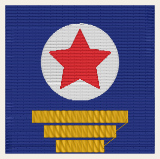
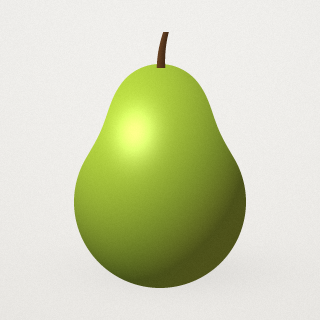
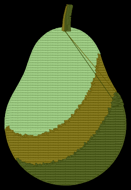
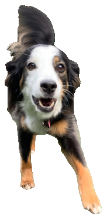
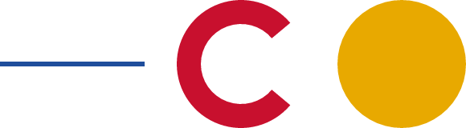
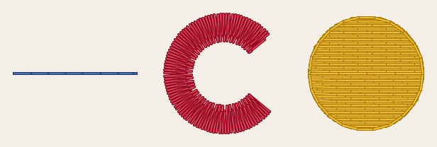
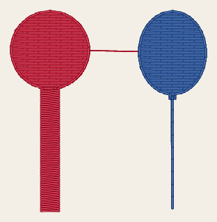
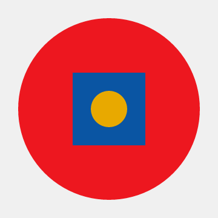
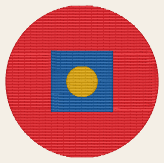

# Automatic digitizing

Automatic digitizing makes a machine file from a picture without a setting on any of its shapes. StitchCraft
chooses the stitches of each shape from its shape and mends the places where shapes meet. It also orders the
sewing for few colour changes. It is made for 2 kinds of picture:

- [Flat-colour art](#flat-colour-art), such as logos, badges, clip art and drawings. Its colours are solid
  shapes, stacked in layers or abutting.
- [A photo reduced to a few flat colours](#a-photo-in-a-few-colours), such as 4. It sews in those flat
  colours, as flat-colour art does.

## Flat-colour art

Logos, badges, clip art and drawings have a few flat colours, each of them one solid shape or more. The
emblem below, `docs/fixtures/emblem.svg`, is drawn in layers in 4 of the machine's threads, each layer whole
under the layers drawn over it.

**The picture**

<!-- shot: auto-emblem-picture -->

<!-- /shot -->

**Digitized**

<!-- shot: auto-emblem -->

<!-- /shot -->

The navy square and the white disc are broader than a satin column, and each is filled whole under the
shapes on it. The bars are 3 mm tall and sew as satin columns. The white round the square is the picture's
background, the fabric's own colour, and is left out.

To digitize such art:

- Art drawn in VectorCraft, or opened there from an SVG file, is made of shapes already. Select them,
  choose **Effect › Plug-ins › StitchCraft Auto**, and write the machine file
  ([how](../how-to/embroider-a-vectorcraft-design.md#write-the-machine-file)). On the command line,
  [`stitch plan`](../reference/cli.md#stitch-plan) and `stitch export` digitize a VectorCraft document so
  without a switch, and `--no-auto` sews its shapes as drawn. Add `--auto` for an SVG file, as in
  `stitch plan emblem.svg --auto -o emblem.pes`.
- A picture of the art, a PNG or JPEG file, is traced into shapes first, in the machine's threads.
  `stitch plan emblem.png -o emblem.pes` traces it with VectorCraft's command line, then digitizes the shapes.
  In VectorCraft, Image Trace traces it
  ([from a picture to a machine file](../tutorials/picture-to-machine-file.md)).

## A photo in a few colours

A photo's colours blend into each other. VectorCraft's Image Trace reduces them to a few flat colours first,
such as 4 of the machine's threads, the backdrop's colour among them. The traced shapes are then digitized as
flat-colour art is. The photo sews in those few flat colours, and its blended shading isn't reproduced.
[Image to embroidery](../../design/image-to-embroidery.md) leaves photos sewn in blended colours outside the
roadmap.

**The photo**

<!-- shot: auto-pear-photo -->

<!-- /shot -->

**Traced in 4 threads**

<!-- shot: auto-pear-traced -->

<!-- /shot -->

**Digitized**

<!-- shot: auto-pear -->

<!-- /shot -->

**Digitized, on black fabric**

<!-- shot: auto-pear-black -->

<!-- /shot -->

The photo is drawn in code for these pages. `stitch plan` traced it 90 mm across with VectorCraft 0.19.0, into
`docs/fixtures/traced-pear.vectorcraft`. The pear's shading became 3 bands of green, and the backdrop the
4th colour, which is left out as the picture's background. The thread of each darker band sews a side of
the stem too, between the band's 2 ends. The thin straight lines are the jumps to the stem and back, which
the reference machine leaves for you to cut by hand ([machine profiles](../reference/profiles.md)).

To digitize a photo:

- `stitch plan pear.png --colours 4 --size 90 -o pear.pes` traces the photo in 4 threads, 90 mm across, and
  digitizes the shapes. `--colours` counts the backdrop's colour too.
- In VectorCraft, trace it with Image Trace's **Colors** set to 4, then give the traced shapes StitchCraft's
  Auto effect
  ([from a picture to a machine file](../tutorials/picture-to-machine-file.md#2-trace-the-picture-in-those-threads)).

## A photo with its background removed

A photo's background, such as the turf a dog stands on, traces into shapes of its own, which sew too. To sew
the subject alone, remove the background first, in any program that makes it transparent, and save the
photo as a PNG file. Image Trace leaves transparent pixels out. The photo then traces into its subject's
shapes alone ([subject cut-out](../../design/image-to-embroidery.md#subject-cut-out)).
Then `stitch plan dog.png --colours 9 --size 100 -o dog.pes`, or Image Trace in VectorCraft, traces and
digitizes it as any photo. The owner's photos of her dog were made that way. A mask checked by hand cut
each out, as `--subject` will from M13.14.

**The photo, cut out**

<!-- shot: auto-dog-photo -->

<!-- /shot -->

**Traced in 9 threads**

<!-- shot: auto-dog-traced -->

<!-- /shot -->

**Digitized**

<!-- shot: auto-dog -->

<!-- /shot -->

**Digitized, on black fabric**

<!-- shot: auto-dog-black -->

<!-- /shot -->

`stitch plan` traced the cut-out 100 mm tall with VectorCraft 0.22.0, into
`docs/fixtures/traced-dog-running-9.vectorcraft`. The fur's shading became flat patches in 9 threads, which
digitize as fills, satin columns and triple runs by their shape ([stitches by shape](#stitches-by-shape)).
Its ragged patches sew as flat fills, and its nose as one fill with the nostrils on it. Its thin, ragged
strands of fur sew as part of the patches beside them ([thin lines](#neighbours)). The fabric is covered
where the dog has a colour, on black fabric as on cream ([covering the fabric](#covering-the-fabric)). 4
stitches still lie where they shouldn't, beside thin pieces of fur. They are 1.8 to
4 mm long. M13.38 of the [roadmap](../../plan/roadmap.md) is to remove them, and the like stitches of the
other traced dogs. The thin straight lines are jumps between patches of one colour, which the reference
machine leaves for you to cut by hand, as it leaves the pear's: 64 of them. Where patches sewn later cover a
way from one patch to the next, StitchCraft sews the thread under them instead ([jump threads](#jump-threads)).
The dog changes thread 11 times in its 9 threads, since a line sews after the fill it borders: with **Fill
uneven parts** off it changes thread less often and jumps more often
([what it costs](../../design/image-to-embroidery.md#what-it-costs)).

## How it chooses the stitches

Automatic digitizing chooses the stitches of each shape without settings. A shape with settings sews as they
say. The pictures below show shapes as they are drawn, and then digitized automatically. Sewn as drawn, an
SVG file without `--auto` or a VectorCraft document with `--no-auto`, each of those shapes sews as one
[tatami fill](tatami-fill.md), whatever its width.
[Image to embroidery](../../design/image-to-embroidery.md) gives every rule in full.

### Stitches by shape

Each part of a shape sews by the first rule that it matches. The rules go by the part's shape alone,
never by what the picture shows: a flower and a dog sew by the same rules. The
[rules' reference](../reference/auto-rules.md) has the table with each bound's value, and
[image to embroidery](../../design/image-to-embroidery.md#which-stitch-a-shape-gets) says why each rule
is there.

- **A line.** A part nowhere wider than the design's narrowest satin stroke runs along its middle, as a
  triple run when it is wide enough to show.
- **An area.** A part wider than the widest satin column somewhere is a tatami fill.
- **A blob.** A part no wider than a satin column, and short for its width, is a small tatami fill. A
  column along its middle would sew its stitches into a fan round a point. The smallest blob is a dot.
- **A ragged patch.** A part that branches, and whose width swells and shrinks along its branches, is a
  tatami fill too. Sewn as a column along each branch, its edge would be scalloped. Its thin tails leave
  the fill and run.
- **A column.** Any other part sews as satin columns between its own edges, as a letter, a leaf, a ring and a
  tapering stroke do.

A satin stitch longer than 7 mm lies loose, so a part whose column would sew one is filled instead, unless
[wide columns](#wide-columns) are on. A part that is filled is filled whole under the shapes that fill its holes, and they sew on it.

A letter's counter, such as the hole in an A or an O, shows the fabric or the field under it where a disc
0.8 mm across fits in it and nothing drawn later lies over it: the columns round it end their stitches on
its edge, without the pull compensation that widens them elsewhere. A smaller counter closes under its
own threads. Straight columns keep their edges straight, and where a column bends or fans, the stitches
that crowd on the inside of the bend are shortened.

The pictures are drawn from `docs/fixtures/rules.svg`. Its 5 shapes are a blob, a letter T of a thick and a
thin stroke, a blob with 2 tails, a nose with 2 nostrils and a leaf.

**As drawn**

<!-- shot: auto-rules-drawn -->

<!-- /shot -->

**Digitized**

<!-- shot: auto-rules -->

<!-- /shot -->

The T shows the rule's limit. Each of its strokes is even, but they are unlike each other, so the letter as
a whole counts as ragged and is filled. For art drawn in strokes of changing thickness, turn **Fill uneven
parts** off, or use the `logo` style ([changing the choice](#changing-the-choice)), and the T sews as 2
satin columns.

A small star is filled too. Its centre line runs from one point to the point opposite, and one satin
column along that line would sew the other points as bumps on its sides. StitchCraft measures how far a
shape lies from its centre line on both sides, and fills one that lies much farther out than a column
does. A cross with square arms sews a column along each arm, and a letter V keeps its columns: its corner
lies on one side only.

Each fill sews an outline: a running stitch round its edge in its own thread, sewn after its rows. The outline
draws the points of a small shape, which the ends of a fill's rows leave blunt, and its stitches are
shorter where the edge bends, so that the outline of a round shape is round. It sews where the edge shows, and not along
an edge that a shape sewn later covers. To sew without outlines, turn **Outline round fills** off in the
Auto effect's dialog, or on the command line:
`stitch plan badge.svg --auto -o badge.pes --set auto_fill_outline=false`. A traced photo then sews about
a tenth fewer stitches, and leaves a few jump threads fewer to cut.

### Stitches by width

A line, a column and an area differ by their width. A shape's width at a place is the diameter of the
largest circle that fits inside it there. A stroke is a line as wide as it is drawn, and its width chooses
its stitches: one as wide as a satin column sews as a
[satin column drawn as one path](satin-column.md#drawn-as-one-path). The
pictures are drawn from `docs/fixtures/widths.svg`, a line 0.6 mm wide, a letter C 3 mm wide and a disc
16 mm across, each traced as an area.

**As drawn**

<!-- shot: auto-widths-drawn -->

<!-- /shot -->

**Digitized**

<!-- shot: auto-widths -->

<!-- /shot -->

### Shapes in parts

A shape can be broad in one place and narrow in another, such as a letter with thin serifs or a balloon
on a string. Its broad parts are filled, and its narrow parts sew as columns and lines that reach into
the fill. The pictures are drawn from `docs/fixtures/parts.svg`, a lollipop on a stick 2.4 mm wide and a
balloon on a string 0.8 mm wide, each one area.

**As drawn**

<!-- shot: auto-parts-drawn -->

<!-- /shot -->

**Digitized**

<!-- shot: auto-parts -->

<!-- /shot -->

### Neighbours

The shapes of a traced picture meet, and sewn without `--auto` they sew badly there. Digitizing mends that
in 6 steps:

1. **The background.** The lowest shape, when it covers the whole picture with the other shapes drawn
   on it, is the background, the fabric's own colour, and is left out (`SC-W0906`, and
   `auto_ignore_background` to keep it). What shows of it inside the picture still sews, such as a white
   disc on a badge whose colours are stacked.
2. **Layers.** VectorCraft's Image Trace draws a picture's colours abutting, each area with a hole where
   the next one lies, or stacked, each colour whole under the colours drawn over it. Each shape sews only
   what shows of it, and a picture sews alike whichever way it was traced. A broad area with details on it,
   such as dots on a flower's middle, is filled whole. It sews first, and its details sew on top. Outlines
   and letters, no wider than a satin column (`auto_max_satin_width_mm`), keep their holes, and the shapes
   inside them sew beside them (`SC-I0908`).
3. **Thin lines.** A photo traces soft shading and the strands of fur as thin, ragged lines between
   patches. Each would sew as a running stitch that the fills beside it end their rows on. So a part
   narrower than a satin column can be, whose width varies along it, sews as part of the fill of the shape
   it shares the longest edge with (`SC-I0915`). A line of even width, as a pen draws it, sews as a
   line. Turn **Fill uneven parts** off (`auto_fill_uneven`) to keep every line, as the `logo` style does.
   A line that doesn't touch another piece of its colour, such as a twig or the pale rim of a petal, is a detail
   of its own, and merged it is lost. So lines merge only while the picture keeps a share of its detail,
   **Least likeness kept when lines merge** (`auto_min_likeness`), those of the colours with the most
   pieces first, and the rest sew as lines. The default, 0.85, keeps 0.75 or more of every picture
   measured. Each line kept sews as a running stitch and can add a jump thread: the photos measured sewed 61
   to 274 more shapes as running stitches and 50 to 236 more jump threads. Lower the setting for fewer jump
   threads where the fine lines matter less, such as a photo sewn small, or set it to 0 to merge every line.
   Keeping lines changes the order the shapes sew in. The cap on thread (`auto_thick_cap_fills`) holds
   every spot to 4 fills in any order.
4. **Specks.** A shape or a part of one smaller than 1 mm² would sew a knot. It is merged into the shape
   it shares the longest edge with (`SC-I0905`, `auto_min_area_mm2`).
5. **Overlaps.** The thread pulls stitches in from the edges of their shape, so shapes that only meet show
   fabric between them once sewn. Each area reaches 1 mm under the shapes sewn after it that it
   touches (`SC-I0904`, `auto_overlap_mm`). An area filled whole under its details is cut away under them,
   1 mm inside their edges, so that each place sews once. A satin column sews 1 mm past a side that a
   shape sewn after it runs along, and 0.4 mm past any other side (`auto_pull_compensation_mm`).
6. **The base layer.** One open underlay sews first under the whole design
   ([covering the fabric](#covering-the-fabric)).

The pictures are drawn from `docs/fixtures/traced-badge.svg`, a badge traced on white with its colours
abutting. Without `--auto`, the white round the badge sews too, and each colour sews up to the next with no
overlap.

**As drawn**

<!-- shot: traced-badge-drawn -->

<!-- /shot -->

**Digitized**

<!-- shot: auto-badge -->

<!-- /shot -->

### Covering the fabric

You can't choose the colour of the fabric a design is sewn on, and on black fabric every place the thread
leaves bare is a dark spot. So a design digitized automatically sews one base layer first, under all of
it: an open fill of stitches 3 mm long, in the thread that the picture has the most of. Its rows run across the rows of the fills on it. For a towel or a fleece, `auto_base_rows` set to `lattice` sews it in 3
directions, which holds the pile down and lays 3 times the thread. It
lies 0.4 mm inside the design's outline, so that it doesn't show beside the edge. The fills sewn on it
sew no underlay of their own (`SC-I0909`).

With the base layer and the overlap of 1 mm, the pear and the traced dogs cover the fabric inside their
outlines. Where
thin lines of fur meet, the top thread still leaves a sliver here and there, and the base layer's thread
shows in it in place of the fabric. The running dog above has none in
1,944 mm² of design, and the same dog in 6 threads has 1, of 0.26 mm². With the base layer that dog sews
2,112 stitches fewer than with an underlay under each fill, and the pear 199 fewer.

To sew without the base layer, turn `auto_base_layer` off. Each fill then sews its own underlay, and
StitchCraft says that fabric may show between shapes (`SC-I0911`). The
[settings](../reference/params/auto.md) also set the base layer's stitch length, whether it keeps the
design's holes, and, among the advanced ones, its offset. 2 more are limits that StitchCraft's own checks hold a design to, and
nothing sews differently by them: the largest sliver, 0.4 mm², and the most the top thread may leave to
the base layer, 0.5 % of the design. The reference machine hasn't sewn a base layer yet, and
[MC-8](../../plan/machine-testing.md) sews the dog on black fabric with it and without.

### How thick it sews

Shapes that overlap put thread on thread, and a needle that has to go through too much of it deflects
and shreds or breaks the thread. StitchCraft measures every design it digitizes: how many fills of thread
lie over each spot, and how many times the needle goes down in each square millimetre. One fill is what
a tatami fill lays by default. When a place of 1 mm² or more has 4 fills or more, or 15 needle points or
more, `stitch plan` warns (`SC-W0913`) and still writes the file. The warning names the thickest spot and
the shapes stacked there.

StitchCraft aims to keep every spot at 3.25 fills or less, a limit called the cap. Once the design is planned,
a last pass and then the cap take thread away at each spot above it. They take thread that other stitches
cover, first under the shapes sewn later and then where a shape lays its stitches twice over the same
place. They take only the stitches of the shapes they digitized. Below 4 fills they leave a satin column's top
stitches and the rows under its edge. A column keeps its edge and its angle. What shows keeps its
colour, and no jump thread or thread change is added. `SC-I1119` says what they took and what is left above
the cap, which is mostly where 2 satin columns meet over a fill.

Above 4 fills, the warning's limit (`auto_thick_warn_fills`), a spot is too thick to sew well. There the last
pass and the cap take the rows under a column's edge too, and what is still above 4 fills then loses a
column's top stitches, one at a time, those that change the column least, until the spot is at 4 fills. The
warning comes only where a place of 1 mm² has 4 fills or more. The advanced setting `auto_thick_cap_fills`
moves the cap.

<!-- shot: auto-dog-thickness -->

<!-- /shot -->

`stitch preview dog.pes --style thickness -o thick.png` draws this picture of any machine file. Grey is
thread under 2 fills, yellow is 2 or more, orange 4 or more and red 6 or more. On the dog above, a few specks
are orange: its thickest spot has 4.0 fills, and 94 mm² of 1,944 mm² has 3 fills or more, where it had
177 mm² with the cap at 4.
Before StitchCraft sewed an area's overlap by the way its rows run, and one overlap alone under a
shape, 629 mm² was orange or red, and M13.30 left 280 mm² and a thickest spot of 7.0 fills.

The limits are starting values for a 75/11 needle and 40-weight polyester thread. They come from the
public advice of machine and software makers, who disagree. The reference machine hasn't sewn a design
to confirm them yet. Until [MC-8](../../plan/machine-testing.md) has, sew a test piece of the
thickest part before a whole design, slowly, and listen for the needle thumping. The
[settings](../reference/params/auto.md) `auto_thick_warn_fills` and the 3 beside it move the limits.

### Sewing order

The shapes sew in an order StitchCraft chooses. 6 rules decide it, each where the rules before it leave a
choice:

1. Of 2 shapes that overlap, the lower sews first, as drawn.
2. A running line sews after a fill it borders, and covers its edge.
3. The thread changes as seldom as rules 1 and 2 allow. On a machine with one needle, each change is a
   rethread by hand. Each thread sews every shape it can before the next thread starts, and StitchCraft
   searches for the row of threads with the fewest changes.
4. A satin column sews after a fill it borders where that costs no thread change. Where it sews first, it
   reaches 1 mm under the fill.
5. A detail, such as an eye or a mark on a patch, sews after the larger shapes round it where that costs
   no thread change, so that no fill's rows lie over it. Any shape whose neighbours close in on it and
   are larger counts as one. StitchCraft finds it by its outline and its neighbours alone, not by what
   the picture shows.
   The rule is off by default. It costs no thread change, but on traced photos it leaves 1 to 7 more
   jump threads to cut by hand and shows no more of the picture. Turn it on with
   `--set auto_details_last=true` when no fill's rows may lie over the edge of an eye or a mark, as on a
   logo or a drawing with small marks on large patches. The cap on thread still limits every spot to 4
   fills.
6. Of the shapes a thread may sew, the nearest sews next.

One thread or another comes back where the rules need it. Dark outlines sew after the light fills they
border, and a dark fill under those sews before them. A picture in 6 threads changes thread 5 times at
least. Traced from a photo in 6 threads, a dog changes thread 8 times, and in 9 threads 12 times.
Fewer thread changes leave more jump threads to cut, because the machine cuts the thread at a change and
not at a jump. `stitch plan` says how often the thread changes, and `SC-I0907` compares the order with
paint order.

### Jump threads

Between 2 shapes of one thread that don't touch, the needle jumps. A machine with one needle, such as the
reference machine, leaves the thread of a jump for you to cut. Where shapes sewn later cover a
way from one shape to the next, StitchCraft sews a run along it instead: stitches 2.5 mm long at most,
0.4 mm or more inside what covers them, which you won't see once those shapes are sewn. The run goes round
a place where it would show, as long as that is no farther than twice the jump and 10 mm. A run under the
outline that follows a fill, in the fill's own thread, lies where the outline will.

What is left are the jumps that nothing sewn later covers:

- the jumps of the thread that sews last, and of the lines that sew after the fills they border
- a jump across a shape sewn earlier, or across bare fabric
- a jump whose end lies more than 0.8 mm from the nearest place that a later shape covers
- the jumps between shapes with settings of their own, which sew as you set them

A traced dog leaves 60 to 83 jump threads where it left 73 to 96. The traced pear keeps its 2, to the
stem and back over the background, which sews nothing. A stitch shorter than 3 mm from one shape to the next stays a
stitch, as before. Where it would show on another colour for 1 mm or more, it becomes a run if a way is
covered. The runs are always on. `SC-I0914` says when a design needs more work than the budget
allows to look for them, and then sews with its jumps.

### Settings by width

Each satin column digitizing makes has the underlay of its width, and 0.4 mm of pull compensation:

| Column width | Underlay |
|---|---|
| Below 2 mm | Centre walk |
| 2 to 4 mm | Contour |
| Above 4 mm | Contour and zigzag |

Fills keep a tatami fill's defaults, but sew no underlay of their own on the base layer, and turn from row to row in a stitch at the outline. These are starting values, which the next
sew-out at the machine checkpoint confirms or changes.

### Text

A text that is still text in the drawing sews as lettering in an embroidery font, whose letters were
digitized one by one for the needle. An SVG file's text is such a text, and so is point type in a
VectorCraft document. The word stands where the drawing has it, on its baseline and about as tall, in the
text's colour.

Its letters are not those of the drawing's typeface. StitchCraft can't read a typeface's letter shapes yet,
so every text comes out in the embroidery font's letters, which are light and upright in Ink/Stitch Small
Font. A bold text sews in Barstitch Bold, whose strokes are half again as wide, when its font size is 51
points (17.9 mm) or more. A smaller bold text sews in Small Font, and the report says from what size it
would sew bold. Small Font's letters are wider than most typefaces', so a line at the text's height would often run past
the shape it is drawn on. StitchCraft keeps each line to the length the text most likely had in the
drawing: half the font size for each character, or the length an SVG file states with `textLength`. It
closes the letters up a little, then sews the line smaller. The report says for each text which font was
used, how tall it sewed and why, and how long its longest line is (`SC-I1116`):

```sh
STITCHCRAFT_FONTS=~/embroidery-fonts stitch plan badge.svg --auto -o badge.pes
```

`stitch` finds the font in the folder `STITCHCRAFT_FONTS` names, and VectorCraft's exporters have Small
Font built in. Without a font the text is left out, and `SC-W1111` says so.

- **To keep the typeface's look**, make paths of the text in the drawing program, with Path › Object to Path
  in Inkscape or Type › Create Outlines in VectorCraft. The letters then sew as shapes.
- **To choose the embroidery font and its size** in VectorCraft, give the text StitchCraft's Lettering
  effect ([letter in VectorCraft](../how-to/letter-in-vectorcraft.md)).
- **To sew the design without the text**, hide or delete the text in the drawing.

Small Font sews letters from 3.6 to 15.2 mm tall, which is text from about 15 to 61 points. Smaller and
larger text sews at the nearest of those heights, and `SC-W1106` says so. A line that is still too long
at 3.6 mm sews at 3.6 mm, and `SC-W1117` says by how much it is longer than the text's place. Text on a path, vertical text and
VectorCraft's area type are left out with a warning.

### Smoothed outlines

A traced outline wobbles by less than a thread is wide. The wobble can't show in thread, but it sews short
stitches along the edge, and a ragged edge where 2 colours meet. **Smooth outlines** (`auto_smooth_mm`)
smooths each automatic area's outline before anything is digitized, with no point moved farther than the
setting:

```sh
stitch plan photo.jpg -o photo.pes --set auto_smooth_mm=0.2
```

Corners stay where they are. Where 2 areas meet, their shared edge is smoothed once, so no gap opens
between them. StitchCraft leaves an outline as drawn when its area would change by more than a tenth. A shape with settings is never
smoothed. The report says how many outlines were smoothed (`SC-I0921`).

It is off by default, for traced pictures and documents alike, and no dialog shows it. Smoothing changes
which parts of a shape sew as satin columns, and not every change is better: the traced dogs sew a quarter
of their shapes by another rule at 0.2 mm, with a few more stitches astray and more area at 3 fills. Try
it on a traced photo, whose outlines wobble most. At 0.2 mm, half a thread, the test photos sewed a fifth
fewer stitches under 0.5 mm and planned in about half the time. On flat art or a traced drawing it changes
little. On a picture with many thin traced lines it can merge some of them into their neighbours.
[Image to embroidery](../../design/image-to-embroidery.md#the-builds-numbers) gives the numbers for each
test picture.

### Wide columns

A border, a ring or a bar between 7 and 10 mm wide is filled by default. **Widest split satin column**
(`auto_max_split_satin_width_mm`) sews such a part as one satin column instead, its stitches split into
pieces no longer than 7 mm:

```sh
stitch plan border.svg --auto -o border.pes --set auto_max_split_satin_width_mm=10
```

A part sews so when it is wider than a satin column somewhere and no wider than the setting anywhere. It
also has to be a good column, with one centre line along which its width varies little, whose stitches
don't crowd on one edge. A line drawn that wide sews so too. An L, a T, a fork or a wedge that widens from 7 to 10 mm
stays a fill. The splits fall at random places along each stitch, so that their needle holes don't sew a
seam down the middle of the column. On a shape that sets `split_method` or `max_stitch_length_mm` itself, its value is used.

Use it where a wide border should shine as satin does, for a frame round a patch or a band of colour in a
logo. It has a cost. A split column sews about half as much thread again as the fill it replaces, and it
sews thicker where a ring closes over its first stitches. It is off by default, its default the widest
satin column, at which no part is wide, and no style turns it on. The trade sews split satin up to about 10
mm wide. The setting goes up to 12 mm, and wider columns sew thicker still. The machine checkpoint MC-8 sews
bars and rings 6, 8 and 10 mm wide both ways before the default can change. The traced pictures and the
designs in the repository sew the same with it on: their parts that wide are blobs, branch, or crowd.

### Less overlap under a column

Where a narrow part of a shape sews as a satin column over the edge of a fill, the fill lies 1 mm under the
column, its whole overlap. A narrow column then lies wholly on the fill, and the spot sews thick.
**Overlap under a column** (`auto_column_overlap_mm`) keeps less of the fill there:

```sh
stitch plan photo.jpg -o photo.pes --set auto_column_overlap_mm=0.4
```

It changes only the fills under such columns, wide columns with split stitches among them. A fill under another fill, under a running line, or under a
satin column you drew as a stroke or as lettering keeps its overlap. Left empty, the setting is the overlap,
and nothing sews differently.

It is empty by default until a sew-out shows how little is enough, and no dialog shows it. A column's thread
pulls in by about 0.4 mm, its pull compensation, so with less than that fabric may show between the fill and
the column. At 0.4 mm the test pictures sewed less area at 3 fills of thread or more, most of all a traced
patch whose letters are columns on a field. Sew a small piece first, and look along each column's inner edge
for fabric showing between it and the fill, and for a ridge where the two lie on each other.
[Image to embroidery](../../design/image-to-embroidery.md#less-overlap-under-a-parts-column) gives the
numbers.

### Smooth satin edges

A satin column's stitches run from edge to edge, and on the inside of a curve they keep their spacing: the
outside opens up to 0.5 mm, where a straight column's stitches lie 0.4 mm apart. Its inside edge sews as one
row. A stitch ends short of the edge only where the spot would otherwise sew more than 4 fills of thread,
where a column fans into a corner over other shapes. There the plan pulls the crowded ends in, a quarter
of the column and then half, and the report says how many (`SC-I1119`).

**Short stitches** (`auto_short_stitches`) gives the look from before:

```sh
stitch plan drawing.svg --auto -o drawing.pes --set auto_short_stitches=crowded
```

With `crowded` every column keeps its spacing on the outside, and every end closer than 0.35 mm to the one
before it on its edge moves in, a quarter of the column, and the next one half. A column sews a little less
thread at the inside of its curves so, and its inside edge shows a second row of short ends. A shape that
sets `short_stitch_distance_mm` or `short_stitch_inset` sews by those settings either way, and so does one
that sets `bend_open_percent`, the satin column's setting for how far the outside opens.

The cost of the default is on the outside of a tight curve. Its stitches lie up to 0.5 mm apart, and
on a thin fabric a thread-thin gap can show between them. Sew the test piece of the next machine
checkpoint both ways before you change the setting on a whole design.

### Changing the choice

Each shape says which rule chose its stitches, with the numbers that decided it (`SC-I0912`, in the report
of `stitch plan --report`). The settings that change the choice come in 3 tiers:

- **For a shape**, **Stitch** (`auto_stitch`) names its stitch: a running stitch, satin columns or a tatami
  fill. A part that can't sew so goes by the rules.
- **For a design**, **Satin or fill** (`auto_prefer`) leans the rules towards satin columns or towards
  fills, **Fill uneven parts** (`auto_fill_uneven`) turns the filling of ragged patches off, **Fill
  angle** (`auto_fill_angle`) turns every fill's rows, and **Outline round fills** (`auto_fill_outline`)
  turns the outlines off. In VectorCraft, apply StitchCraft's Auto effect to
  the layer or the group, and set them in its dialog.
- **Advanced**, each rule's bound is a setting too, such as the least slenderness of a column, and so is
  the base layer's offset (`auto_base_offset_mm`). No dialog shows these. On the command line, `--set` sets one on every shape digitized automatically:
  `stitch plan photo.jpg -o photo.pes --set auto_min_slenderness=4`.

A style is a named set of these settings. `stitch plan --style logo` suits flat art drawn in strokes: it
prefers satin columns, and fills no uneven part and merges no thin line. `--style photo` is the defaults. The
[rules' reference](../reference/auto-rules.md) lists what each style sets, and every setting with its tier.

Which style a design needs is your choice: StitchCraft doesn't guess it. Flat art, lettering and ink
drawings keep their lines and columns in the `logo` style, and lose detail in the `photo` style. A traced
photo sews thin in the `photo` style, and thick in the `logo` style, where its ragged patches keep their
columns. A picture of both kinds, such as a label on a photo, wants each style in a part of it. Give that
part its own settings in VectorCraft, or hold its lines with a mark (`--keep`).

When the other style would sew the design otherwise, planning says so once
([`SC-I0923`](../reference/diagnostics.md#sc-i0923)). It counts the thin lines merged or kept and the
parts filled or sewn as satin columns that the other style would sew another way, and names that style.
The notice doesn't change what sews, and it doesn't say which style is right: plan the design in the other
style and compare the previews. A design that both styles sew alike doesn't get it.

### Settings

Each rule goes by the settings of the shape it digitizes, and a shape that sets none takes the defaults,
as every shape does with `--auto`. VectorCraft's Auto effect sets them, and the
[reference](../reference/params/auto.md) gives each one's range and default. The narrowest satin column
is the design's `min_satin_stroke_width_mm`, and the underlay of a column's width is no setting.
