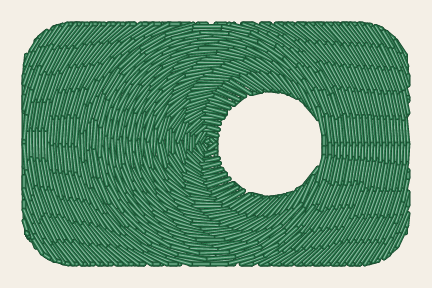
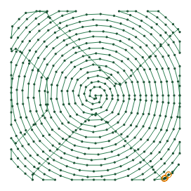
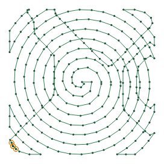
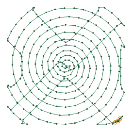
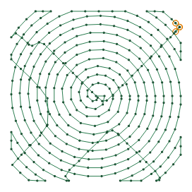
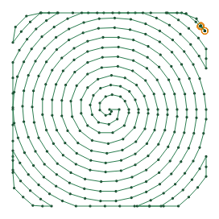

# Circular fill

<!-- stitch-types: circular_fill -->

A circular fill covers an area with a spiral round its middle, as ripples spread round a stone dropped in
water. Its rings lie a row spacing apart. The spiral turns in on every other ring and back out between
them, so it ends near where it began. The area's outline cuts it into pieces, which are sewn one after
another, the needle running between them under the pieces not sewn yet. Set a fill's `fill_method` to
`circular_fill` for it.

Its settings are set as every stitch type's are ([setting parameters](./#setting-parameters)).

Here is the green patch of `docs/fixtures/fill.svg` that the [tatami fill](tatami-fill.md)'s pictures
show, 32 mm by 20 mm with a round hole, sewn as a circular fill. The pictures further down show the square
with rounded corners of `docs/fixtures/meander.svg`, 30 mm a side.

<!-- shot: circular-fill -->
| Circular fill |
|:-:|
|  |
<!-- /shot -->

## The spiral

The spiral turns round the middle of each part of the area, its centroid. Its rings lie `row_spacing_mm`
apart, out to 2 spacings past the part's farthest point. With `end_row_spacing_mm` they fade: from the row
spacing at the middle to the end spacing at the part's farthest point, a fill denser at its heart. These
pictures leave the underlay out.

<!-- shot: circular-spacing -->
| 1 mm apart | 2 mm apart | 1 mm, fading to 3 mm |
|:-:|:-:|:-:|
|  |  |  |
<!-- /shot -->

In an Ink/Stitch file, a `target_point` command tied to the fill moves the middle to where its symbol
is. Every part of the fill then turns round that point, which may lie outside a part.

## Pieces and travel

Where the part isn't round, the spiral leaves it and comes back at every turn past the largest circle
inside the outline, and the part cuts it into pieces. Each is sewn once, in the order a
[tatami fill](tatami-fill.md) would sew rows with the same ends. The needle runs between them under the
pieces sewn later, which hide it. `underpath` off, it runs along the outline, where it can show.
`angle` turns the lines it runs along, and `skip_last` leaves out the last needle point of each piece.

<!-- shot: circular-travel -->
| Underpath | Along the outline |
|:-:|:-:|
|  |  |
<!-- /shot -->

A round part's spiral may enter it once and leave it once. It is then sewn from the needle along the
outline to where the spiral enters, and from where it leaves along the outline to where the next part or
element starts, each the shorter way round.

A part that lies within its row spacing of its middle, too small for a spiral, is sewn as one circle with
a radius of the row spacing round its middle, and `SC-W0318` says so: the circle may lie partly outside
so small a part. A part that the spiral misses, lying between 2 of its turns, is sewn as a running stitch
round its outline, and `SC-W0305` says so.

## Stitches, underlay and repeats

The spiral sews in stitches as long as `running_stitch_length_mm`, within `running_stitch_tolerance_mm`
of it, as a running stitch sews a stroke, and with `enable_random_stitch_length` at random lengths, which
`random_seed` chooses. Bean stitch sews each of its stitches back and forth, but not the travel between
pieces. The repeats work as they do for a contour fill
([contour fill](contour-fill.md#stitches-underlay-and-repeats)).

Before its spiral, each part of the fill sews the tatami fill's underlay, on by default
([tatami fill](tatami-fill.md#underlay)): rows square to the fill's `angle`. `expand_mm` grows the area
before the spiral is laid over it.

## Parameters

The reference gives each setting's range and default:

- [fill](../reference/params/fill.md), which chooses the fill method
- [tatami fill](../reference/params/tatami.md), its row spacing and end spacing, the needle's way between
  pieces, and its underlay and expanding
- [path fills](../reference/params/path-fill.md), its repeats and bean stitch
- [running stitch](../reference/params/running.md), its stitch length and tolerance, and random lengths
- [the settings every element shares](../reference/params/common.md), the random seed among them
