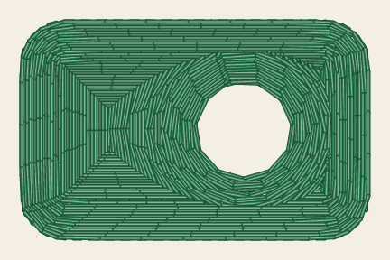
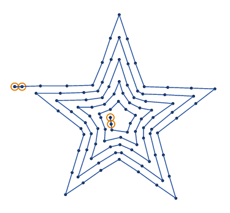
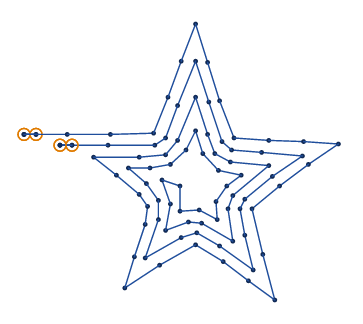
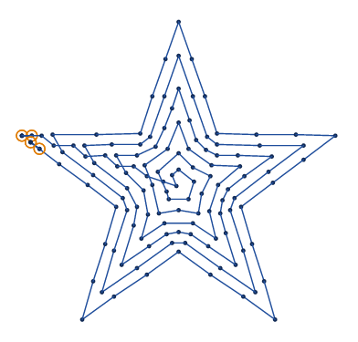
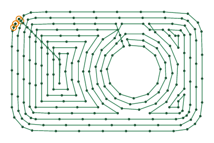
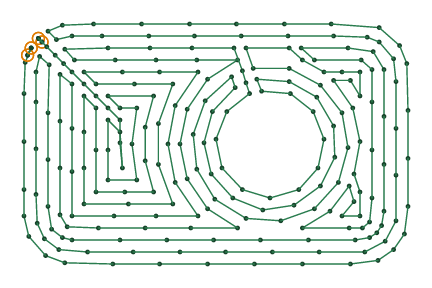
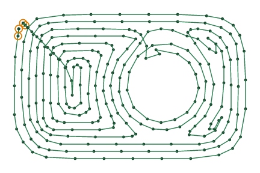

# Contour fill

<!-- stitch-types: contour_fill -->

A contour fill covers an area with rings that follow its outline inward, a row spacing apart, like the
growth rings of a tree, and with rings round its holes. It sews them all as one line of running
stitches that runs from ring to ring with no travel, so it suits round and flowing shapes. Set a fill's
`fill_method` to `contour_fill` for it.

Its settings come from the VectorCraft plug-in today, and from an SVG file's Ink/Stitch attributes once
the SVG reader reads them ([setting parameters](./#setting-parameters)).

The pictures are drawn from `docs/fixtures/fill.svg`, the green patch 32 mm by 20 mm with a round hole
that the [tatami fill](tatami-fill.md)'s pictures show, and from `docs/fixtures/star.svg`, a blue star.
As the patch sews:

<!-- shot: contour-fill -->
| Contour fill |
|:-:|
|  |
<!-- /shot -->

## Strategies

`contour_strategy` chooses how the line runs through the rings. These pictures and the next ones space
the rings 1 mm apart and leave the underlay out, and draw a dot at each needle point, to show them.

- **Inner to outer**, `0` and the default, starts on the outline nearest the needle and steps in, ring by
  ring, to the middle. It sews each ring round as it comes back out, and ends on the outline beside where
  it began.
- **Single spiral**, `1`, turns from the outline in to the middle, where it ends.
- **Double spiral**, `2`, turns in on every other ring and back out between those turns, and ends near
  where it began.

<!-- shot: contour-strategies -->
| Inner to outer | Single spiral | Double spiral |
|:-:|:-:|:-:|
|  |  |  |
<!-- /shot -->

Where the rings part, at a neck or round a hole, inner to outer goes into each part, one after the
other. A spiral follows one chain of rings, and leaves the others out: `SC-W0311` says how many. Sew such
a shape inner to outer. A part too narrow for its spiral is sewn inner to outer, and `SC-I0315` says so.

## Corners

`join_style` shapes the rings' corners: round, `0` and the default, mitred, `1`, or bevelled, `2`. They
differ where the rings bend round a corner that juts into the shape, such as the star's corners between
its points or a hole's. Mitred rings have a sharp corner there all the way in, and round and bevelled ones
round it off or cut it across, more on each ring.

<!-- shot: contour-joins -->
| Round | Mitred | Bevelled |
|:-:|:-:|:-:|
|  |  |  |
<!-- /shot -->

## The line

`clockwise` runs the rings clockwise as the drawing shows them, or the other way when it is off. Inner to
outer runs a ring with rings inside it that way, and the innermost rings the other way, so the step out
of a ring crosses the step into it. `avoid_self_crossing` alternates the rings' direction ring by ring
instead, and the steps don't cross. `smoothness_mm` rounds the line off, cutting its corners and steps
over about 5 times that length, and keeps it inside the shape. The spirals are neither smoothed nor kept
inside.

<!-- shot: contour-path -->
| Steps crossing | Alternating | Smoothed by 1 mm |
|:-:|:-:|:-:|
|  |  |  |
<!-- /shot -->

## Stitches, underlay and repeats

The line sews in stitches as long as `max_stitch_length_mm`, within `running_stitch_tolerance_mm` of it,
as a running stitch sews a stroke: random lengths and bean stitch work as they do there
([running stitch](running.md#bean-stitch-and-repeats)). `repeats` sews the whole line again for each
repeat after the first, the other way round, along everything sewn so far: 2 sews it there and back,
and 3 there and back twice.

Before its rings, each part of the fill sews the tatami fill's underlay, on by default
([tatami fill](tatami-fill.md#underlay)): rows square to the fill's `angle`, which turns only the
underlay here. `expand_mm` grows the area before its rings are laid.

## Parameters

The reference gives each setting's range and default:

- [fill](../reference/params/fill.md), which chooses the fill method
- [contour fill](../reference/params/contour.md), its strategy and corners and its direction
- [tatami fill](../reference/params/tatami.md), its row spacing, underlay and expanding
- [path fills](../reference/params/path-fill.md), its smoothing, repeats and bean stitch
- [running stitch](../reference/params/running.md), its tolerance and random lengths
- [the settings every element shares](../reference/params/common.md), the stitch length among them
