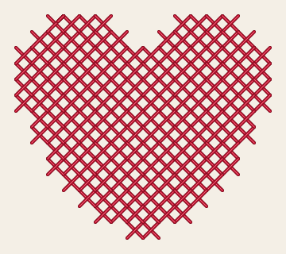
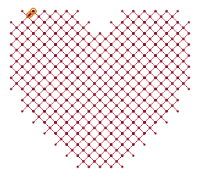
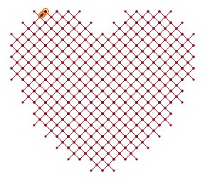
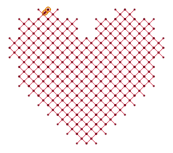
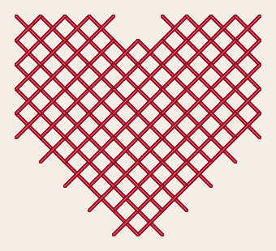
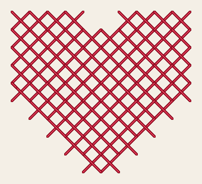

# Cross stitch

<!-- stitch-types: cross_stitch -->

Cross stitch fills an area with crosses, as hand embroiderers count them on even-weave fabric: a grid of
equal cells lies over the area, and each cell the area covers enough of sews a cross. Every cross is the
same size, in rows and columns, and a curved edge steps along the grid's lines. It suits letters and motifs
drawn as pixels, and Ink/Stitch's cross-stitch fonts are sewn this way. Set a fill's `fill_method` to
`cross_stitch` for it.

Its settings are set as every stitch type's are ([setting parameters](./#setting-parameters)).

Here is the heart of `docs/fixtures/heart.svg`, 32 mm wide, sewn as a cross stitch fill. On the left it has
Ink/Stitch's defaults, cells of 3 mm and 4 threads, and on the right a 2 mm grid with 2 threads, as most of
Ink/Stitch's cross-stitch fonts sew.

<!-- shot: cross-stitch -->
| 3 mm grid, 4 threads | 2 mm grid, 2 threads |
|:-:|:-:|
|  |  |
<!-- /shot -->

## The grid

`pattern_size_mm` sets the cells' size. One length gives square cells, and 2 separated by a space give
the width and then the height. Smaller cells follow the shape more closely and take more stitches. The
grid's lines pass through the canvas's origin, `canvas_grid_origin` on, so that 2 fills of cross stitch
that lie side by side share one grid and their crosses line up. Move such a fill by part of a cell,
though, and it may sew other crosses. Off, the grid starts at the top left corner of each part of the
fill, and the fill sews the same wherever it lies. In an SVG file the canvas's origin is the page's top
left corner, and in a VectorCraft document the origin of the document, where a new document's first
artboard has its top left corner.

`cross_offset_mm` moves the grid: left by its first length and down by its second, or as far each way by
one length. A move by a whole cell leaves it where it was.

## Which cells sew a cross

A cell sews a cross when the fill covers `fill_coverage` percent of it, 50 by default. Lower, crosses are
sewn further past the shape's edges. Higher, they keep further inside them, and at 100 only cells wholly
inside the shape sew. `expand_mm` grows the shape first, by 0.1 mm in Ink/Stitch's fonts, so that a cell
drawn exactly is covered. A part that covers no cell enough sews nothing, and `SC-W0319` says so: make the
cells smaller, or lower `fill_coverage`.

<!-- shot: cross-coverage -->
| 25 % covered | 50 % covered | 90 % covered |
|:-:|:-:|:-:|
|  |  |  |
<!-- /shot -->

## Each cross

A cross sews its `\` diagonal first and then its `/` diagonal over it, so every cross's top diagonal lies the
same way, as in hand cross stitch. Between the 2 the needle passes through the cell's middle, where the top
diagonal covers it. `cross_stitch_method` set to `simple_cross_flipped` lays the `/` diagonal under the `\`
one instead, on the same grid. The other kinds of cross, half, upright, double and Smyrna, arrive in a later
version, and a fill set to one is skipped for now (`SC-W0011`).

<!-- shot: cross-flipped -->
| Simple cross | Flipped |
|:-:|:-:|
|  |  |
<!-- /shot -->

`cross_thread_count` sets how many times the thread passes along each diagonal, 4 by default. The needle
comes back to where it started, and the count is even. An odd count sews the even count below it, and 1
sews 2, with `SC-W0320`. 2 threads give a lighter cross, which suits small grids, and 4 a bolder one. A
diagonal longer than `max_cross_stitch_length_mm`, 11 mm by default, is sewn in equal stitches no longer.

## The order of the crosses

Crosses that meet, side by side or corner to corner, are sewn in one run, and the needle jumps only between
groups that don't. Each cross joins the run at one of its corners, its top diagonal's where it can, so that
the stitches through its middle lie under that diagonal. A cross that the run comes to only at a corner of
its bottom diagonal ends with a stitch from its middle back to that corner, on top. A fill of one group first
runs from where the needle comes in to where it ends, near the next element, from corner to corner through
the middles of the crosses on the way. The crosses sewn after hide those stitches.

A grid so fine that a cross's stitches from its corners to its middle are shorter than the machine's
shortest stitch loses some of its needle points, and its crosses their shape: `SC-W0321` says so. A cross
stitch fill has no underlay.

## Parameters

The reference gives each setting's range and default:

- [cross stitch](../reference/params/cross.md), the grid, the coverage and the crosses
- [fill](../reference/params/fill.md), which chooses the fill method
- [tatami fill](../reference/params/tatami.md), its `expand_mm`
- [the settings every element shares](../reference/params/common.md), such as its locks and trims
