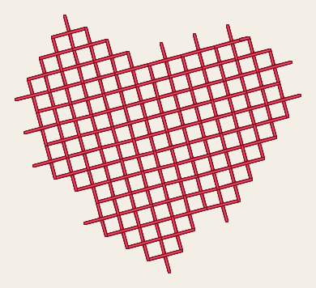
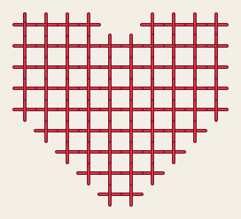
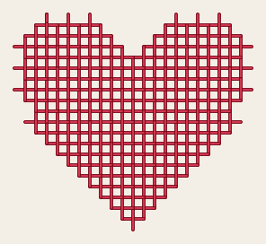
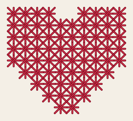
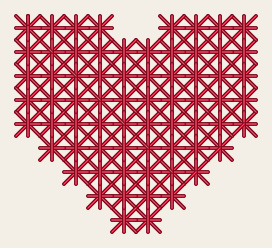
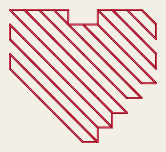
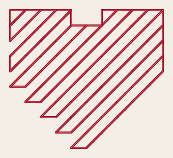

# Cross stitch

<!-- stitch-types: cross_stitch -->

Cross stitch fills an area with crosses, as hand embroiderers count them on even-weave fabric: a grid of
equal cells lies over the area, and each cell the area covers enough of sews a cross. Every cross is the
same size, in rows and columns, and a curved edge steps along the grid's lines. It suits letters and motifs
drawn as pixels, and Ink/Stitch's cross-stitch fonts are sewn this way. Set a fill's `fill_method` to
`cross_stitch` for it.

Its settings are set as every stitch type's are ([setting parameters](./#setting-parameters)).

Here is the heart of `docs/fixtures/heart.svg`, 32 mm wide, sewn as a cross stitch fill. On the left it has
Ink/Stitch's defaults, cells of 3 mm and 4 threads, and on the right a 2 mm grid with 2 threads, as most of
Ink/Stitch's cross-stitch fonts sew.

<!-- shot: cross-stitch -->
| 3 mm grid, 4 threads | 2 mm grid, 2 threads |
|:-:|:-:|
|  |  |
<!-- /shot -->

## The grid

`pattern_size_mm` sets the cells' size. One length gives square cells, and 2 separated by a space give
the width and then the height. Smaller cells follow the shape more closely and take more stitches. The
grid's lines pass through the canvas's origin, `canvas_grid_origin` on, so that 2 fills of cross stitch
that lie side by side share one grid and their crosses line up. Move such a fill by part of a cell,
though, and it may sew other crosses. Off, the grid starts at the top left corner of each part of the
fill, and the fill sews the same wherever it lies. In an SVG file the canvas's origin is the page's top
left corner, and in a VectorCraft document the origin of the document, where a new document's first
artboard has its top left corner.

`cross_offset_mm` moves the grid: left by its first length and down by its second, or as far each way by
one length. A move by a whole cell leaves it where it was.

`cross_rotation` turns the grid, clockwise for a positive angle, and the crosses and the stepped edge
turn with it. A shape turned with its grid, with `canvas_grid_origin` off, sews the same crosses as the
shape unturned, turned with it: a letter of a cross-stitch font turned along a path keeps its crosses
square to its sides this way. On the canvas's grid the grid turns about the point the offset names, so
fills side by side with the same turn still share one grid.

<!-- shot: cross-rotation -->
| 0° | 30° |
|:-:|:-:|
|  |  |
<!-- /shot -->

## Which cells sew a cross

A cell sews a cross when the fill covers `fill_coverage` percent of it, 50 by default. Lower, crosses are
sewn further past the shape's edges. Higher, they keep further inside them, and at 100 only cells wholly
inside the shape sew. `expand_mm` grows the shape first, by 0.1 mm in Ink/Stitch's fonts, so that a cell
drawn exactly is covered. A part that covers no cell enough sews nothing, and `SC-W0319` says so: make the
cells smaller, or lower `fill_coverage`.

<!-- shot: cross-coverage -->
| 25 % covered | 50 % covered | 90 % covered |
|:-:|:-:|:-:|
|  |  |  |
<!-- /shot -->

## Each cross

A cross sews its `\` diagonal first and then its `/` diagonal over it, so every cross's top diagonal lies the
same way, as in hand cross stitch. Between the 2 the needle passes through the cell's middle, where the top
diagonal covers it. `cross_stitch_method` set to `simple_cross_flipped` lays the `/` diagonal under the `\`
one instead, on the same grid.

<!-- shot: cross-flipped -->
| Simple cross | Flipped |
|:-:|:-:|
|  |  |
<!-- /shot -->

`cross_thread_count` sets how many times the thread passes along each half of each bar of a cross, 4 by
default. The needle comes back to where it started, and the count is even. An odd count sews the even count
below it, and 1 sews 2, with `SC-W0320`. 2 threads give a lighter cross, which suits small grids, and 4 a
bolder one. A diagonal longer than `max_cross_stitch_length_mm`, 11 mm by default, is sewn in equal
stitches no longer.

## Other kinds of cross

`cross_stitch_method` chooses the kind of cross, each with a flipped variant, `_flipped` after its name,
that turns each cross a quarter turn on its cell:

- `upright_cross` sews a `+` in each cell: a bar across, from the middle of one side to the middle of the
  other, and a bar down over it. Flipped, the bar across lies on top.
- `dense_upright_cross` adds a second grid of upright crosses half a cell over, each on a corner of the
  first grid's cells, so that the crosses close the gaps between each other. Along the shape's edges they
  reach half a cell past the first grid's crosses where the shape covers enough of their cells.
- `double_cross` sews a simple cross with an upright cross between its 2 diagonals, its `/` diagonal on
  top. Ink/Stitch's font Jersey 15 sews it, with 2 threads.
- `smyrna_cross` sews a simple cross and an upright cross over it, its bar down on top.

Each of them is sewn in runs as a simple cross is, each cross a loop from one of its ends back to it, and
takes the same even thread count on each half of each bar. With 4 bars through each cell's middle, a double
or a Smyrna cross packs much thread there: 2 threads suit them on small grids.

<!-- shot: cross-methods -->
| Upright | Dense upright | Double | Smyrna |
|:-:|:-:|:-:|:-:|
|  |  |  |  |
<!-- /shot -->

## Half crosses

`half_cross` sews only the `\` diagonal of each cell, and `half_cross_flipped` only the `/` one. The
diagonals that meet end to end are sewn as one row, and the needle goes from row to row along the stepped
outline of the cells, where the travel shows. Each stitch of a row is sewn there and back until it lies an
odd number of times: `cross_thread_count` when it is odd, and one more when it is even, with `SC-W0322`.
Set 3 for a stitch that lies 3 times, or 1 for a light one.

<!-- shot: cross-half -->
| Half cross | Flipped |
|:-:|:-:|
|  |  |
<!-- /shot -->

## The order of the crosses

Crosses that meet are sewn in one run, and the needle jumps only between groups that don't. Simple, double
and Smyrna crosses meet side by side or corner to corner, and upright crosses side by side. Each cross joins
the run at one of its ends, its top bar's where it can, so that the stitches through its middle lie under
that bar. A cross that the run comes to only at an end of a lower bar ends with a stitch from its middle back
to it, on top. A fill of one group first runs from where the needle comes in to where it ends, near the next
element, from end to end through the middles of the crosses on the way. The crosses sewn after hide those
stitches.

A grid so fine that a cross's shortest stitches are shorter than the machine's shortest stitch loses some of
its needle points, and its crosses their shape: `SC-W0321` says so. A cross stitch fill has no underlay.

## Parameters

The reference gives each setting's range and default:

- [cross stitch](../reference/params/cross.md), the grid, the coverage and the crosses
- [fill](../reference/params/fill.md), which chooses the fill method
- [tatami fill](../reference/params/tatami.md), its `expand_mm`
- [the settings every element shares](../reference/params/common.md), such as its locks and trims
