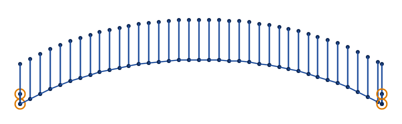
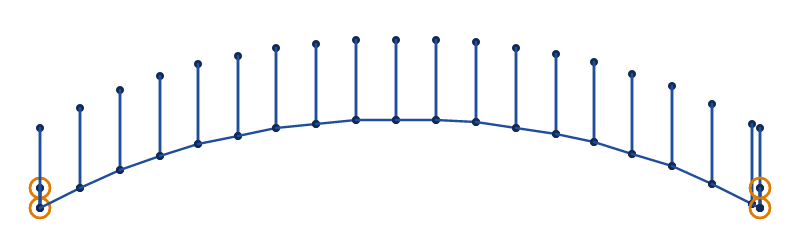
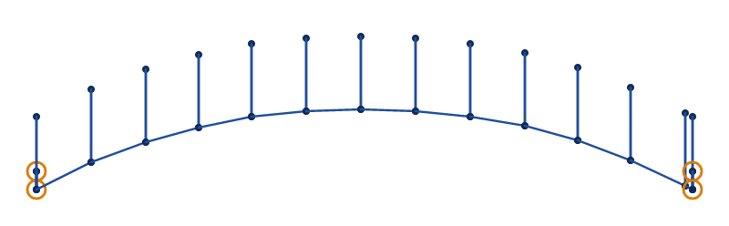
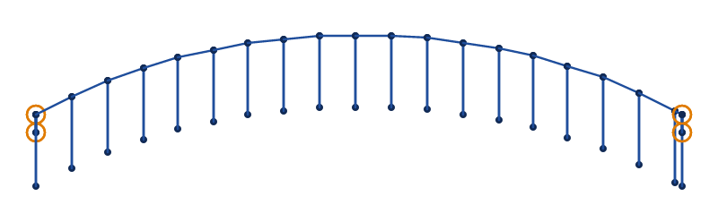

# E-stitch

An E-stitch edges appliqué. A row of stitches runs along one edge of a band, its spine, and at each step
a spike reaches across the band and comes back, like a row of E's laid end to end. It is the blanket
stitch, which holds an appliqué's raw edge down with far less thread than a satin column. Ink/Stitch's
documentation suggests it for appliqué on clothes for small children. Set an element's `satin_column` on
and its `satin_method` to `e_stitch` for it.

Draw it as a satin column, with 2 rails along the band's edges. The spine runs along the first rail, and
the spikes go across to the second. Rungs across the rails, where they turn, keep the spikes square to
the band.

In VectorCraft, join the 2 rails with Object › Compound Path › Make and apply the StitchCraft Satin
effect to them, with its `satin_method` set to `e_stitch`. The effect shows its stitches, and
`stitch export` sews them. An SVG file's Ink/Stitch settings are read from milestone M8
([setting parameters](./#setting-parameters)).

The pictures are drawn from `docs/fixtures/e-stitch.svg`, a curved band 4 mm wide.

## Spacing

`zigzag_spacing_mm` is how far apart the spikes are, 0.4 mm by default as for a satin column. An E-stitch
wants it wider: 2 or 3 mm leaves the fabric between the spikes showing.

<!-- shot: e-stitch-spacing -->
**1 mm**

**2 mm**

**3 mm**

<!-- /shot -->

## Which edge

The spine runs along the first rail, the first subpath the path draws. `swap_satin_rails` puts it on the
other rail, and the spikes then point the other way. Put the spine on the appliqué's outer edge, over the
raw edge of its fabric.

<!-- shot: e-stitch-swapped -->
**Rails swapped**

<!-- /shot -->

## Long spikes and long steps

Spikes longer than `max_stitch_length_mm` are split as a satin column's stitches are, and each spike
comes back down through the needle holes of its own splits. A step of the spine longer than the longest
stitch is split only if the spacing as set is longer than the longest stitch, as in Ink/Stitch, so a step
that `random_zigzag_spacing_percent` lengthens past it is sewn in one stitch. A stitch longer than 12 mm
may snag, and `SC-W0209` names it.

## Leaning stitches

Without enough rungs, the points of the 2 rails pair up by length alone, and where one rail runs on ahead
of the other the spikes lean along the band. Where they lean more than 45° from square to it, `SC-W0208`
names the place to add a rung. Every satin method gives both warnings.

## Parameters

An E-stitch reads every setting of a satin column, from its underlays and compensation to its random
variation and where it starts and ends. The reference lists each one with its range and default:

- [satin column](../reference/params/satin.md)
- [the settings every element shares](../reference/params/common.md)
