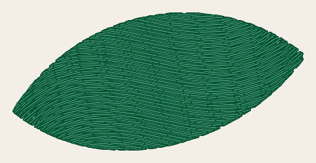
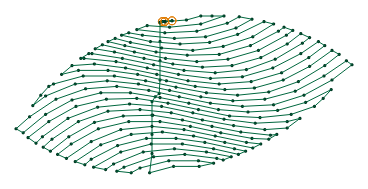
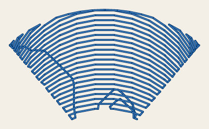
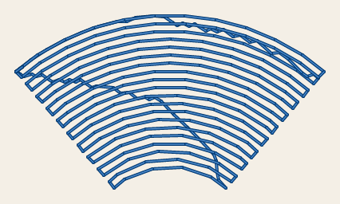
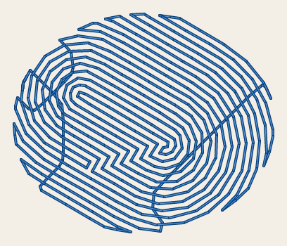
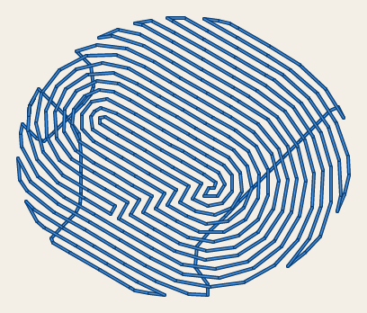
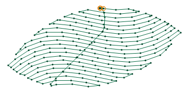
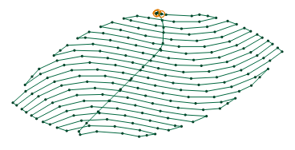

# Guided fill

<!-- stitch-types: guided_fill -->

A guided fill covers an area with rows that bend with a line you draw beside it, the guide. Where a tatami
fill lays straight rows, a leaf or a ribbon reads better with rows that run along its shape, and the guide
says how they run. By default the fill copies the guide across the area a row spacing at a time, and each
copy inside the area is a row. Its [strategies](#strategies) make the rows from the guide in 2 other ways.
Set a fill's `fill_method` to `guided_fill` for it.

Its settings are set as every stitch type's are ([setting parameters](./#setting-parameters)).

Here is the leaf of `docs/fixtures/guided.svg`, 42 mm long, grouped with an S-shaped guide along its
middle, sewn as a guided fill with its defaults:

<!-- shot: guided-fill -->
| Guided fill |
|:-:|
|  |
<!-- /shot -->

## The guide

The guide is a line grouped with the fill and marked as one. It is never sewn.

- **In an SVG file**, a guide line is a path that Ink/Stitch's guide-line marker starts, as for a
  [ripple stitch](ripple-stitch.md#guides). The fill takes the first such line of its group that isn't a
  satin column, since satin guides steer ripple stitches.
- **In a VectorCraft document**, name a path grouped with the fill `stitch:guide`, as for a ripple stitch.
  VectorCraft runs a live effect on its object alone, without the paths beside it. The preview then sews the
  tatami fill below, and `stitch export` sews the rows.

Draw the guide the way the rows should run. Copies and offset curves follow its first subpath alone. A
guide that crosses itself is cut where it does, and its loops are left out. A copied guide that closes on
itself is opened just before its last point. It needn't reach across the fill: each row is lengthened
straight on at both ends, past the area.

A fill without a guide, or with one of no length, is sewn as a [tatami fill](tatami-fill.md) with its own
settings, and `SC-W0331` says so. So is a fill whose copied guide starts and ends at one point.

## The copies

The copies move a row spacing apart, square to the line between the guide's ends, turned clockwise from
it. With `guided_fill_angle` set, they move at that angle instead, in degrees clockwise from horizontal.
An angle near the guide's own direction moves them along it more than across it, and brings the rows closer
together than `row_spacing_mm`. These pictures leave the underlay out:

<!-- shot: guided-angle -->
| Square to the guide | Copy angle 45° |
|:-:|:-:|
|  |  |
<!-- /shot -->

`smoothness_mm` rounds each copy's corners off before it is sewn, over about 5 times that length, as it
rounds a [contour fill](contour-fill.md)'s path off.

The copies can miss a part of the area thinner than the row spacing between 2 of them. That part is sewn as
a tatami fill whose rows run at the angle of the line between the guide's ends, and `SC-W0332` says so. The
other strategies' rows fall back the same way.

## Strategies

`guided_fill_strategy` says how the rows are made from the guide. Its values are Ink/Stitch's numbers.

- **Copy** (`0`), the default, moves copies of the guide across the fill, as above. Where the guide runs
  across the way the copies move, the rows come closer together.
- **Parallel offset** (`1`) sews the guide's offset curves. Each row keeps the row spacing from the one
  before all along it, so the rows of a band that turns stay even. On the inside of a bend tighter than a
  row's distance from the guide, the row turns with a corner. `guided_fill_angle` doesn't apply.
- **Buffer** (`2`) sews rings round the guide, the first half a row spacing from it and the rest a row
  spacing apart, like the rings of a tree. Every subpath of the guide counts, so a guide of 2 short lines
  grows 2 sets of rings that join into one. The guide can lie inside the fill, and can be as short as a
  dash.

Here is the fan of `docs/fixtures/guided-fan.svg`, a band between 2 arcs with an arc between them as its
guide, without underlay and with rows 1 mm apart. The copies crowd towards the fan's ends, and the offset
curves keep their spacing:

<!-- shot: guided-offset -->
| Copy | Parallel offset |
|:-:|:-:|
|  |  |
<!-- /shot -->

And the egg of `docs/fixtures/guided-egg.svg`, whose guide is a short line inside it, as a buffer:

<!-- shot: guided-buffer -->
| Buffer |
|:-:|
|  |
<!-- /shot -->

A ring that closes inside the fill has no end on the outline for the needle to reach it by. Each such ring
is joined into the ring round it, a row spacing along, and the outermost into a row that meets the
outline. The fill then sews as one route, without a jump from ring to ring.

### The anchor line

Where a ring starts decides where its needle points lie, and each joined ring starts beside its join. An
anchor line says where the rings start instead: each row that closes starts where the anchor line crosses
it, so the rings' needle points line up along it. Draw it from the guide outward, across every ring.

- **In an SVG file**, an anchor line is a path that Ink/Stitch's anchor-line marker starts, in the fill's
  group. The fill takes the first that isn't a satin column, and every subpath of it.
- **In a VectorCraft document**, name a path grouped with the fill `stitch:anchor`.

The egg of `docs/fixtures/guided-anchor.svg` has an anchor line from its guide to its top right:

<!-- shot: guided-anchor -->
| Buffer with an anchor line |
|:-:|
|  |
<!-- /shot -->

A buffer's rings don't stagger by their order. Each ring's stagger counts the row spacings it lies from the
guide, so with an anchor line every `staggers`-th ring starts its stitches alike.

## Stitch positions

Each row starts a `staggers`-th of a stitch further along than the row before, so that the needle points of
neighbouring rows don't line up, as a tatami fill's don't. `stitch_position_method` says how the stitches
then lie along each row:

- **Flexible**, the default, spreads each row's stitches evenly between its corners, at most
  `max_stitch_length_mm` each. Most stitches are as long as each other, and the stagger holds near the
  start of each row.
- **Flexible (stagger)** sews whole stitches of `max_stitch_length_mm` from where the stagger starts the
  row, and a shorter one at its end. The stagger then lasts all along the rows.

<!-- shot: guided-stagger -->
| Flexible | Flexible (stagger) |
|:-:|:-:|
|  |  |
<!-- /shot -->

With `enable_random_stitch_length` the stitches vary in length, as a running stitch's do, and
`random_seed` chooses them.

## Underlay, travel and bean stitch

Before its rows, each part of the fill sews the tatami fill's underlay, on by default
([tatami fill](tatami-fill.md#underlay)). `expand_mm` grows the area before the rows are laid over it. The
rows are sewn in the order a tatami fill's rows with the same ends would be, and the needle runs between
them under the rows sewn later, or with `underpath` off along the outline. `skip_last` leaves out the last
needle point of each row. Bean stitch sews each stitch of the rows back and forth, but not the travel
between them.

## Parameters

The reference gives each setting's range and default:

- [fill](../reference/params/fill.md), which chooses the fill method
- [guided fill](../reference/params/guided.md), its strategy, copy angle and stitch positions
- [tatami fill](../reference/params/tatami.md), its row spacing, staggers, the needle's way between rows,
  and its underlay and expanding
- [path fills](../reference/params/path-fill.md), its smoothness and bean stitch
- [running stitch](../reference/params/running.md), its tolerance and random lengths
- [the settings every element shares](../reference/params/common.md), the longest stitch and the random
  seed among them
