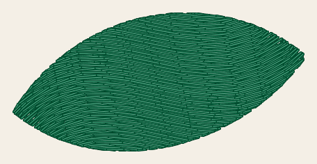
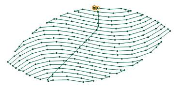
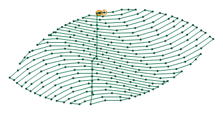
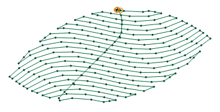

# Guided fill

<!-- stitch-types: guided_fill -->

A guided fill covers an area with rows that bend with a line you draw beside it, the guide. Where a tatami
fill lays straight rows, a leaf or a ribbon reads better with rows that run along its shape, and the guide
says how they run. The fill copies the guide across the area a row spacing at a time, and each copy inside
the area is a row. Set a fill's `fill_method` to `guided_fill` for it.

Its settings are set as every stitch type's are ([setting parameters](./#setting-parameters)).

Here is the leaf of `docs/fixtures/guided.svg`, 42 mm long, grouped with an S-shaped guide along its
middle, sewn as a guided fill with its defaults:

<!-- shot: guided-fill -->
| Guided fill |
|:-:|
|  |
<!-- /shot -->

## The guide

The guide is a line grouped with the fill and marked as one. It is never sewn.

- **In an SVG file**, a guide line is a path that Ink/Stitch's guide-line marker starts, as for a
  [ripple stitch](ripple-stitch.md#guides). A fill takes the first such line of its group that is no satin
  column: a satin guide steers a ripple stitch, and a fill looks past it.
- **In a VectorCraft document**, name a path grouped with the fill `stitch:guide`, as for a ripple stitch.
  VectorCraft's live preview doesn't show the effect the paths beside its object, so the preview sews the
  tatami fill below, and `stitch export` sews the rows.

Draw the guide the way the rows should run. Only its first subpath counts. A guide that crosses itself is
cut where it does, and its loops are left out. One that closes on itself is opened just before its last
point. It needn't reach across the fill: each copy is lengthened straight on at both ends, past the area.

A fill without a guide, or with one that starts and ends at one point, is sewn as a
[tatami fill](tatami-fill.md) with its own settings, and `SC-W0331` says so.

## The copies

The copies move a row spacing apart, square to the line between the guide's ends, turned clockwise from
it. With `guided_fill_angle` set, they move at that angle instead, in degrees clockwise from horizontal.
An angle near the guide's own direction moves them along it more than across it, and brings the rows closer
together than `row_spacing_mm`. These pictures leave the underlay out:

<!-- shot: guided-angle -->
| Square to the guide | Copy angle 45° |
|:-:|:-:|
|  |  |
<!-- /shot -->

`smoothness_mm` rounds each copy's corners off before it is sewn, over about 5 times that length, as it
rounds a [contour fill](contour-fill.md)'s path off.

A part of the area that no copy meets, one thinner than the row spacing between 2 copies, is sewn as a
tatami fill whose rows run at the angle of the line between the guide's ends, and `SC-W0332` says so.

## Stitch positions

Each row starts a `staggers`-th of a stitch further along than the row before, so that the needle points of
neighbouring rows don't line up, as a tatami fill's don't. `stitch_position_method` says how the stitches
then lie along each row:

- **Flexible**, the default, spreads each row's stitches evenly between its corners, at most
  `max_stitch_length_mm` each. Most stitches are as long as each other, and the stagger holds near the
  start of each row.
- **Flexible (stagger)** sews whole stitches of `max_stitch_length_mm` from where the stagger starts the
  row, and a shorter one at its end. The stagger then holds all along the rows.

<!-- shot: guided-stagger -->
| Flexible | Flexible (stagger) |
|:-:|:-:|
|  |  |
<!-- /shot -->

With `enable_random_stitch_length` the stitches vary in length, as a running stitch's do, and
`random_seed` chooses them.

## Underlay, travel and bean stitch

Before its rows, each part of the fill sews the tatami fill's underlay, on by default
([tatami fill](tatami-fill.md#underlay)). `expand_mm` grows the area before the rows are laid over it. The
rows are sewn in the order a tatami fill's rows with the same ends would be, and the needle runs between
them under the rows sewn later, or with `underpath` off along the outline. `skip_last` leaves out the last
needle point of each row. Bean stitch sews each stitch of the rows back and forth, but not the travel
between them.

## Not sewn yet

Copying the guide is the default of Ink/Stitch's `guided_fill_strategy`, and the one StitchCraft sews so
far. Ink/Stitch can also offset the guide, keeping each row a row spacing from the one before, or grow rings
out from it. Those come with a later version, and until then a fill set to either is left out, and
`SC-W0011` names it.

## Parameters

The reference gives each setting's range and default:

- [fill](../reference/params/fill.md), which chooses the fill method
- [guided fill](../reference/params/guided.md), its copy angle and stitch positions
- [tatami fill](../reference/params/tatami.md), its row spacing, staggers, the needle's way between rows,
  and its underlay and expanding
- [path fills](../reference/params/path-fill.md), its smoothness and bean stitch
- [running stitch](../reference/params/running.md), its tolerance and random lengths
- [the settings every element shares](../reference/params/common.md), the longest stitch and the random
  seed among them
