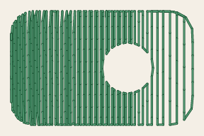
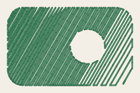
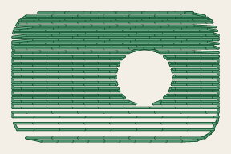

# Linear gradient fill

<!-- stitch-types: linear_gradient_fill -->

A linear gradient fill sews the colours of a gradient. Its rows run across the area, square to the
gradient. Between 2 of its stops, the rows go to the 2 colours. The first takes most rows near its stop,
and the second most rows near the next. Thread can't mix 2 colours, but from a step away the rows blend.
Each colour sews in a thread of its own. Paint the shape with a linear gradient and set its `fill_method`
to `linear_gradient_fill`.

Its settings are set as every stitch type's are ([setting parameters](./#setting-parameters)).

The pictures show the 3 squares of `docs/fixtures/gradient.svg`, each 30 mm a side, without underlay.

<!-- shot: gradient-stops -->
**Rows 0.25 mm apart**

**Rows 0.5 mm apart**

<!-- /shot -->

## The gradient

The fill sews the gradient its shape is painted with, as a viewer draws it. In an SVG file it is the
`<linearGradient>` of the shape's `fill`, with its stops and its vector in user units or in shares of the
shape's box. Its `gradientTransform` applies too ([SVG input](../../design/svg-input.md#gradients)). In
VectorCraft it is the object's fill, a linear gradient placed with the Gradient tool or fitted to the object
at its angle. The element's thread is the first colour the gradient shows.

A stop of opacity 0 is transparent: its rows are left out, and the fabric shows there. Any other opacity
sews the stop's colour. Stops with one colour share its thread. A stop within 2 rows of the blend before is
passed over, and its colour doesn't start a blend. `SC-W0330` names it, since the row after the blend before
is left out there, as Ink/Stitch leaves it out.

A shape painted with a plain colour, or a radial gradient, sews its own colour fading out along its
`angle`, as Ink/Stitch sews it. Its rows thin out from the near side to none, and `SC-W0329` says so.

<!-- shot: gradient-fade -->
| At 0° | At 30° | At 90° |
|:-:|:-:|:-:|
|  |  |  |
<!-- /shot -->

## Rows

The rows lie `row_spacing_mm` apart, square to the gradient's vector, and run past the shape's outline,
which cuts them. Each row's needle points lie the longest stitch apart (`max_stitch_length_mm`), staggered
from the row before's by `staggers` as on a tatami fill. With `enable_random_stitch_length`, each row is a
running stitch of random lengths. `expand_mm` grows the shape first. Each stop lies at a row of its own.
Stops close together sew a sharp change of colour, and stops far apart a gradual one.

## Colours and their order

Each part of the fill sews the tatami fill's underlay first, in the colour of the gradient's first stop
([tatami fill](tatami-fill.md#underlay)). Its rows run along the gradient and cross the top rows, unless
`fill_underlay_angle` sets their angles. Then the colours sew their rows in the order of the stops. A
colour's stitches start at its first row and end at its last, and the needle follows the outline from row
to row. The first colour runs on from the underlay. With `stop_at_ending_point` on, the last 2 colours sew on
along the outline to where the fill ends.

The fill trims after each colour when its `trim_after` is on, since each colour is a colour block of its
own. In a fill of several parts, all the parts' underlays and rows of one colour sew together, one colour
after another, and each thread is sewn once.

## Test sheet

Below its tartans, TS-17B sews 3 gradients 40 mm square for the next machine checkpoint, each in Brother's
threads ([test sheets](../reference/test-sheets.md)). One blends 2 stops, and 2 blend 3. The middle stop of
the last is transparent.
