# Meander fill

<!-- stitch-types: meander_fill -->

A meander fill covers an area with one line that wanders through it and never crosses itself, as a
quilter's meander does. The line runs along the sides of a tiling, hexagons by default, turning where
they meet, and passes no point twice, so it fills the area evenly with turns of the tiling's shape. Set a
fill's `fill_method` to `meander_fill` for it.

Its settings are set as every stitch type's are ([setting parameters](./#setting-parameters)).

The first picture is drawn from `docs/fixtures/fill.svg`, the green patch 32 mm by 20 mm with a round
hole that the [tatami fill](tatami-fill.md)'s pictures show, and the others from
`docs/fixtures/meander.svg`, a square 30 mm a side with rounded corners. As the patch sews:

<!-- shot: meander-fill -->
| Meander fill |
|:-:|
| 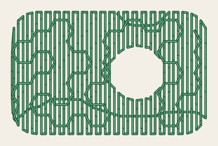 |
<!-- /shot -->

## Tiles

`meander_pattern` chooses the tiling whose sides the line wanders along. Each side is 2 mm long at a
`meander_scale_percent` of 100. These pictures leave the underlay out and draw a dot at each needle
point, to show the line.

<!-- shot: meander-tiles -->
| Honeycomb | Squares | Triangles | Octagons and squares |
|:-:|:-:|:-:|:-:|
| 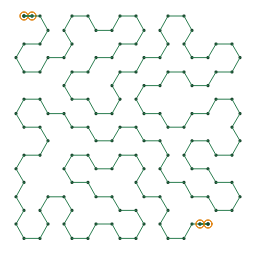 | 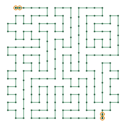 | 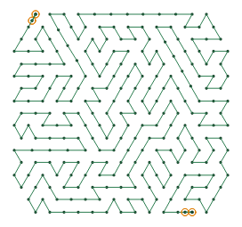 | 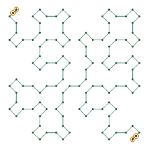 |
<!-- /shot -->

<!-- shot: meander-tiles-more -->
| Hexagons and triangles | Hexagons, squares and triangles | Squares and triangles |
|:-:|:-:|:-:|
| 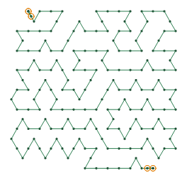 | 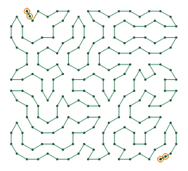 | 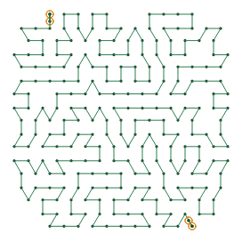 |
<!-- /shot -->

Ink/Stitch's meander tiles are drawings that come with it, which StitchCraft doesn't have. A fill set to
one of them, such as `N3-11a`, Ink/Stitch's default, wanders through the honeycomb instead, and
`SC-W0316` names the tile. Set `meander_pattern` to one of the tiles above to choose another.

## Scale and angle

`meander_scale_percent` scales the tiling: 50 halves its sides to 1 mm, and 200 doubles them. 2
percentages separated by a space scale it across and down apart. `meander_angle` turns it, in degrees
clockwise as the drawing shows it.

<!-- shot: meander-scale -->
| 50 % | 200 % across, 100 % down | Turned 30° |
|:-:|:-:|:-:|
| 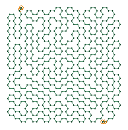 | 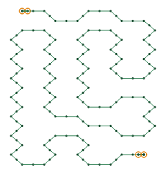 | 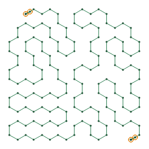 |
<!-- /shot -->

A part too small for the tiling, with no ring of its sides inside it, is sewn as a running stitch round
its outline, and `SC-W0317` says so. A smaller scale lets the line in.

## The line

The line starts at the point of the tiling nearest the needle. It ends nearest where the next part, or
the next element, starts, or else half way round the outline from where it began. It first takes the
way of fewest sides between the two, then swaps sides, and pairs of sides, picked at random, for longer
ways round through points it hasn't passed, until it can swap none. `random_seed` picks them: another
seed wanders another way.

`smoothness_mm` rounds the line's turns off over about 5 times that length. `zigzag_spacing_mm` sews it
as a zigzag across it, from one side to the other every half spacing, `zigzag_width_mm` wide. Smoothing
and the zigzag may take the line out of the shape, and `clip` keeps it inside the shape as drawn.

<!-- shot: meander-line -->
| Smoothed by 1 mm | Zigzag | Zigzag, clipped |
|:-:|:-:|:-:|
| 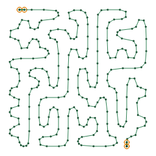 |  | 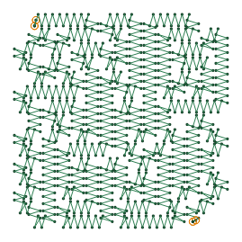 |
<!-- /shot -->

## Stitches, underlay and repeats

The line sews in stitches as long as `running_stitch_length_mm`, within `running_stitch_tolerance_mm`
of it, as a running stitch sews a stroke. A zigzag sews each of its points, unless clipped. Bean stitch
and `repeats` work as they do for a contour fill
([contour fill](contour-fill.md#stitches-underlay-and-repeats)).

Before its line, each part of the fill sews the tatami fill's underlay, on by default
([tatami fill](tatami-fill.md#underlay)): rows square to the fill's `angle`, which turns only the
underlay here. `expand_mm` grows the area before the tiling is laid over it.

## Parameters

The reference gives each setting's range and default:

- [fill](../reference/params/fill.md), which chooses the fill method
- [meander fill](../reference/params/meander.md), its tiling with its scale and angle, and its zigzag
  and clipping
- [path fills](../reference/params/path-fill.md), its smoothing, repeats and bean stitch
- [tatami fill](../reference/params/tatami.md), its underlay and expanding
- [running stitch](../reference/params/running.md), its stitch length and tolerance
- [the settings every element shares](../reference/params/common.md), the random seed among them
