# Ripple stitch

<!-- stitch-types: ripple_stitch -->

A ripple stitch sews lines that spread out from a stroke. Copies of its line shrink towards a point or
follow a guide, or lines run along a satin column from one of its edges to the other. Every line is a
running stitch, and the whole ripple sews as one run. Use it for light textures that fade to a point, such
as a shell or the rings round a flower's heart. With a guide, it repeats a pattern along a curve. Set an
element's `stroke_method` to `ripple_stitch` for it.

In VectorCraft, set the StitchCraft Stroke effect's `stroke_method` to `ripple_stitch`. In an SVG file, the
line's settings are Ink/Stitch's attributes ([setting parameters](./#setting-parameters)).

TS-17C sews one ripple of each kind:

<!-- shot: ripple-kinds -->

<!-- /shot -->

## Kinds of ripple

The stroke's lines give the kind of ripple:

- **An open line** ripples towards its target point. Each copy of the line is the one before it shrunk
  towards the point, and the last copy shrinks to the point. With a [guide](#guides), its copies follow the
  guide instead.
- **A closed line** spirals in to its target point, each turn a smaller copy of the line. With a guide, its
  copies follow the guide.
- **2 lines or more** are a satin column's rails and rungs, drawn as for a [satin column](satin-column.md).
  The first line lies on the first rail and the last on the second, and the lines between follow both.

A part of the path that is one point sews nothing, and `SC-W0401` names it.

## The target point

In an SVG file, Ink/Stitch's target point command tied to the stroke places the point the ripple shrinks
to. In a VectorCraft document, a small path named `stitch:target` grouped with the stroke places it, at the
middle of the box round its anchors. Without either, the target point is the middle of the area the line
spans, the centroid of its convex hull. A ripple along a column has no target point.

## How many lines

`line_count` is the number of lines, 10 by default, the stroke's own line and the target point among them.
With `min_line_dist_mm`, the count is the shortest distance from the line to the target point, or across
the column, divided by it. The count keeps the parity of `line_count`, odd or even, so that the ripple ends
on the same side however large it is drawn. A ripple has 1,000 lines at most (`SC-W0407`).

`exponent` spaces the lines. At 1 they lie evenly apart, and above 1 they crowd towards the first line.
`flip_exponent` crowds them towards the last line instead.

<!-- shot: ripple-lines -->
| Evenly spaced | Exponent 2 | Exponent 2, flipped |
|:-:|:-:|:-:|
|  | 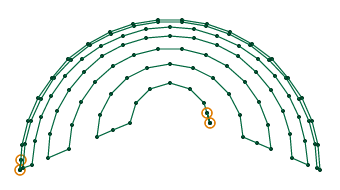 | 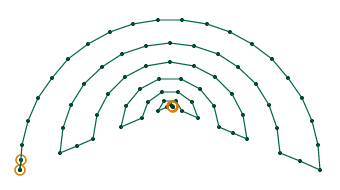 |
<!-- /shot -->

`skip_start` leaves out the first lines, such as the stroke's own line, and `skip_end` the last, such as
the lines that crowd round the target point. Skips that together would leave out every line leave out none
(`SC-W0408`).

## Joins

With `flip_copies` on, the default, every other line is sewn backwards, and the ripple goes back and
forth. `join_style` sets how each line meets the next. With the flat join, `0` and the default, a straight
run of stitches joins each line's end to the next line's start. With the point join, `1`, each line bends
into the next so that they meet at a point, and the ripple has a line more to bend.

With `flip_copies` off, every line is sewn the same way, and the needle goes straight from each line's end
to the next line's start. A spiral is always sewn so.

<!-- shot: ripple-joins -->
| Flat join | Point join | One way |
|:-:|:-:|:-:|
| 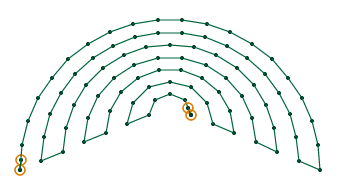 | 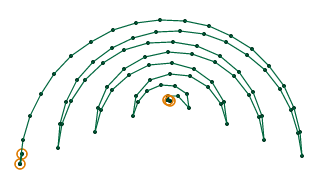 | 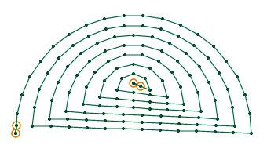 |
<!-- /shot -->

## Staggers

`staggers` moves where each line's needle points fall, so that the needle points of lines side by side
don't line up. Each line's needle points start a staggers-th of the stitch length further back than the
line's before. At 0, every line is placed from the end it is sewn from. The default, 1, places every
line's needle points from its start. Ink/Stitch's settings window shows 0, and it sews a file that sets
none as 1.

## Guides

A guide makes a ripple's copies of its line follow it, in place of shrinking towards a point. In an SVG
file, Ink/Stitch's Selection to guide line makes a path a guide line: it starts the path with Ink/Stitch's
guide-line marker. The guide steers the strokes grouped with it, and is not sewn. In a VectorCraft
document, name a path grouped with the stroke `stitch:guide`. TS-17C sews a guided ripple of each kind:

<!-- shot: ripple-guided -->

<!-- /shot -->

### Along a guide line

A guide of one line moves the copies along it, from its start to its end. Each copy moves to its place
along the guide, and with `rotate_ripples` on, the default, it turns as the guide turns. The copies grow or
shrink evenly from `scale_start` to `scale_end` percent, 100 and 0 by default, so that they shrink to
nothing at the guide's end. `scale_axis` scales them across alone, `1`, down alone, `2`, or not at all,
`3`. `line_count`, `min_line_dist_mm` and `exponent` place the copies along the guide as they place a
ripple's lines. With `satin_guide_pattern_position` set to `render_at_rungs`, a copy lies at each point of
the guide instead. Ink/Stitch asks for such a guide to be a manual stitch, whose points are its nodes. A
guide of curves has a point wherever it is flattened.

<!-- shot: ripple-guide-line -->
| Turning, to 40 % | Not turning | Turning, full size |
|:-:|:-:|:-:|
| 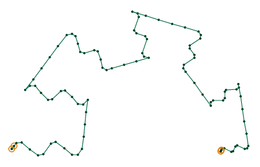 | 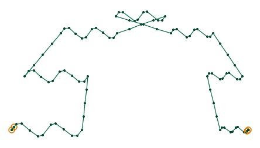 | 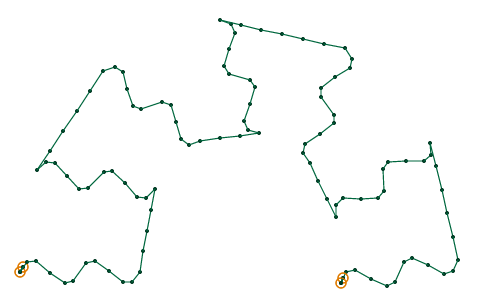 |
<!-- /shot -->

### Between a satin guide's rails

A guide drawn as a [satin column](satin-column.md), with 2 rails and rungs, sets each copy across it: the
copy turns and stretches so that the ends of the line lie on the 2 rails. The ripple's `reverse_rails` and
`swap_satin_rails` say how its rails are read. `satin_guide_pattern_position` places the copies:

- **Line count**, the default, spreads them evenly along the band, as many as `line_count` or
  `min_line_dist_mm` gives.
- **At the rungs** sets one at the end of each section between rungs.
- **Adaptive** sets each one as soon as the box round it clears the one before by `min_line_dist_mm`.

<!-- shot: ripple-satin-guide -->
| Line count, 6 | At the rungs | Adaptive, 1 mm apart |
|:-:|:-:|:-:|
| 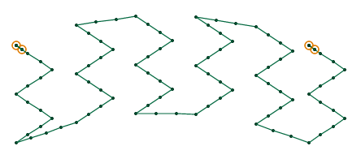 | 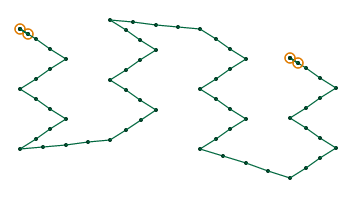 | 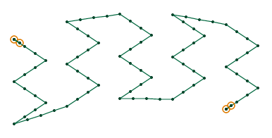 |
<!-- /shot -->

A closed line, such as a small circle, is centred between the rails instead. It grows and shrinks as the
band widens and narrows, and turns as the band turns when `rotate_ripples` is on.

### The anchor line

An anchor line sets which points of the line lie on a satin guide's rails: the start and the end of the
anchor line, in place of the line's own ends. Draw it across the line, and Ink/Stitch's Selection to anchor
line marks it in an SVG file. In a VectorCraft document, name a path grouped with the stroke
`stitch:anchor`. A closed line with an anchor line is stretched across the rails so too, not centred.

### Unusable guides

A guide line of no length can't place copies, and neither can a satin guide whose rails can't be read.
`SC-W0409` says why, and the ripple sews as if it had no guide, towards its target point. An anchor line
whose ends are one point is left out the same way.

## Grids

`grid_size_mm` adds a grid: lines across the ripple's own, each through the same point of every line. The
needle points of the line, or the pairs across a column, then lie the grid size apart, and so do the
grid's lines. The grid sews after the ripple as a run of its own, starting at its corner nearest where the
ripple ended. `grid_first` sews the grid first, and the whole ripple backwards.

## Placing the copies by hand

With `manual_pattern_placement` on, the copies are made of the nodes of the line as you drew them, in place
of its running stitch. Each copy is sewn through its own nodes, and a straight run of even stitches joins
it to the next. With `flip_copies` on, every other copy is sewn backwards, the first among them.

## Clip paths

A ripple cut to clip paths sews only what lies inside them. Its lines cross the clip's edges again and
again, so StitchCraft sews the pieces inside as a fill sews its rows, going along the clip's edge from one
to the next, without a jump between them. A ripple wholly outside its clip paths isn't sewn, and
`SC-W0013` says so.

## Stitches, repeats and bean stitch

Each line is sewn with the running stitch's `running_stitch_length_mm` and `running_stitch_tolerance_mm`,
and with random stitch lengths when they are on. `reverse` sews the whole ripple backwards. `repeats` sews
each run there and back, and `bean_stitch_repeats` then sews it as it sews a
[running stitch](running.md#bean-stitch-and-repeats). Lines near the target point can be shorter than the
shortest stitch the machine sews well, and StitchCraft leaves their needle points out when it finishes the
plan (`SC-I0504`).

## Not applied

A ripple along a column reads its rails without `push_compensation_mm`, which Ink/Stitch applies to them,
and `SC-W0406` names it when it is set.

## Parameters

The reference lists each parameter with its range and default:

- [ripple stitch](../reference/params/ripple.md)
- [running stitch](../reference/params/running.md)
- [repeats and bean stitch](../reference/params/repeat.md)
- [the stroke method](../reference/params/stroke.md)
