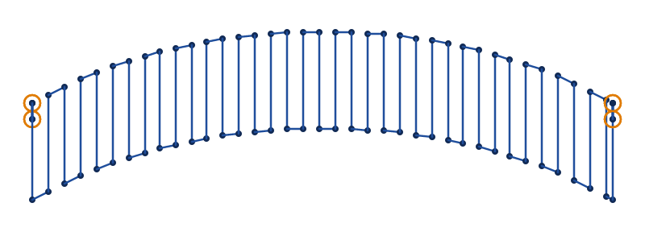
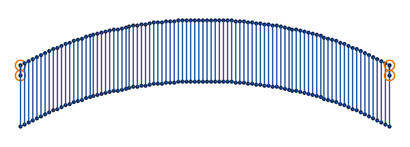
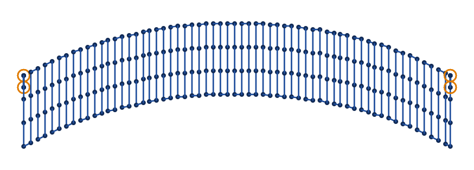
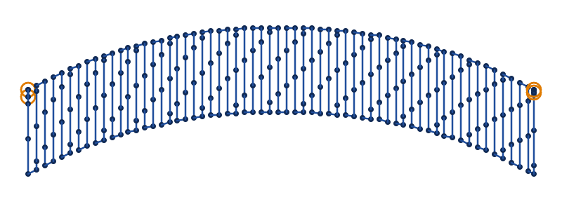

# S-stitch

An S-stitch is a satin column sewn one way at a time. At each step one stitch crosses the band, the next
crosses back, and between them the needle runs a short way along an edge. Its thread draws S's laid end
to end. Split by a longest stitch, its stitches lie across the band in rows that follow it, the look
of a fill that bends with the shape. Turn an element's `satin_column` on and choose `s_stitch` as its
`satin_method`.

Draw it as a satin column, with 2 rails along the band's edges and rungs across them where they turn. The
first stitch goes from the second rail to the first, and `swap_satin_rails` starts it from the other.

In VectorCraft, make the 2 rails one path with Object › Compound Path › Make, give it the StitchCraft
Satin effect, and set the effect's `satin_method` to `s_stitch`: VectorCraft draws the stitches, and
`stitch export` sews them. StitchCraft reads the same settings from an SVG file's Ink/Stitch attributes
from milestone M8 ([setting parameters](README.md#setting-parameters)).

The pictures are drawn from `docs/fixtures/s-stitch.svg`, a curved band 6 mm wide.

## Spacing

`zigzag_spacing_mm` is how far apart the stitches across are, 0.4 mm by default. Each goes the other way
from the one before. A satin column at the same spacing crosses the band twice as often, as its needle
comes back across between its stitches. A finer spacing covers the band more closely.

<!-- shot: s-stitch-spacing -->
**1 mm**

**0.4 mm**

<!-- /shot -->

## Split stitches

With `max_stitch_length_mm` set, a stitch across longer than it is split, as a satin column's stitches
are. By default the splits of neighbouring stitches line up, in rows along the band. The staggered split
method moves each stitch's splits along from the last one's. The rows then slant, and the needle holes of
neighbouring stitches no longer line up.

<!-- shot: s-stitch-split -->
**Default**

**Staggered**

<!-- /shot -->

A step along an edge is never split, however long, as in Ink/Stitch. Where the spacing is wider than the
longest stitch, the steps are longer than it.

## Leaning and long stitches

Where the stitches lean more than 45° from square to the band, without enough rungs, `SC-W0208` names the
place to add one, and `SC-W0209` names a top stitch longer than 12 mm, which may snag. Every satin method
gives both.

## Parameters

Every satin column setting applies to an S-stitch too, its underlays, compensation and random variation
included. The reference gives each one's range and default:

- [satin column](../reference/params/satin.md)
- [the settings every element shares](../reference/params/common.md)
