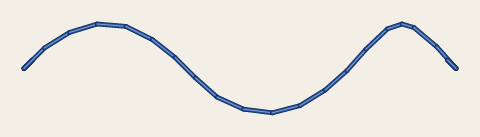
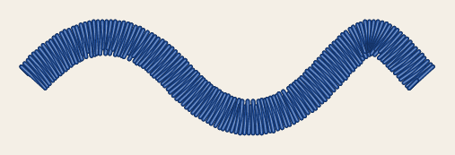
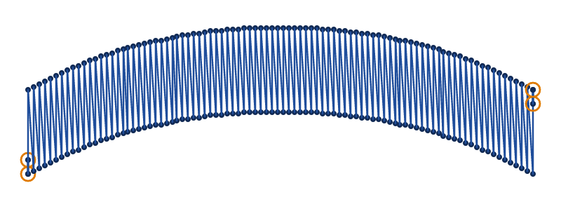
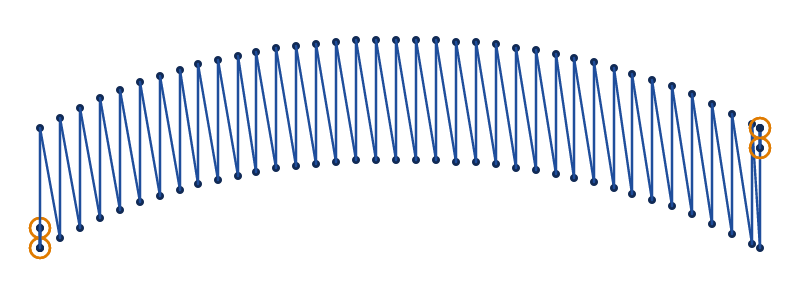
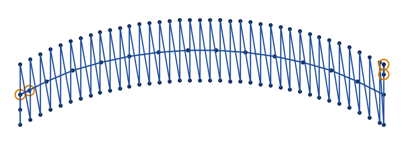
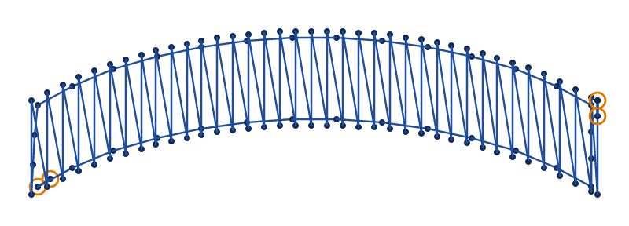
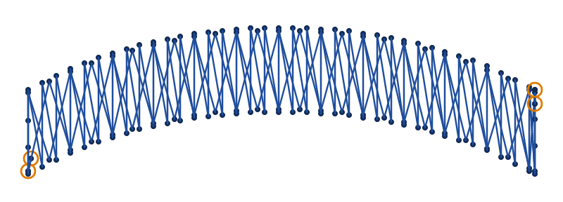

# Satin column

<!-- stitch-types: satin_column -->

A satin column sews a band with stitches straight across it, close side by side, so that the thread lies
smooth and catches the light. The needle crosses the band, comes back across slanting a little to where
the next stitch starts, and so on to the band's end. It is the stitch of borders, lettering and outlines
too wide for a running stitch. Past about 7 mm its stitches lie loose and can snag
([embroidery basics](../explanation/embroidery-basics.md)), so a wider band is split or filled.

Turn an element's `satin_column` on, and draw the band in one of 2 ways:

- **One path with a stroke.** The path is the column's middle, and the column is as wide as the stroke.
  The stroke's joins and caps shape its corners and ends.
- **2 rails.** 2 subpaths along the band's edges, and rungs, short lines across both, where the band turns.
  The stitches run between the rails, at the angle the rungs give them.
  [Satin columns and presets in VectorCraft](../how-to/vectorcraft-columns-and-presets.md) shows how to
  draw both in VectorCraft, and how to make a line into rails and rungs.

`satin_method` chooses how the band is sewn. A satin column is the default, and each other method has a
page of its own among the [stitch types](./). The VectorCraft plug-in sets these settings, and
StitchCraft reads them from an SVG file from milestone M8 ([setting parameters](./#setting-parameters)).

The pictures are drawn from `docs/fixtures/zigzag.svg`, a wave drawn 3 mm wide as one path, and
`docs/fixtures/s-stitch.svg`, a curved band 6 mm wide between 2 rails.

## Drawn as one path

A path with a stroke sews as a column as wide as the stroke, its middle along the path. Its rails lie
half the stroke's width to each side of the path, and rungs cross it at the path's nodes and on either
side of each sharp corner, where the stitches fan round it. Automatic digitizing sews a stroke this way
when it is wider than the design's narrowest satin stroke and no wider than the widest satin column
([automatic digitizing](automatic.md)).

<!-- shot: satin-column-one-path -->
**Running stitch, as a stroke sews by default**

**Satin column**

<!-- /shot -->

## Spacing

`zigzag_spacing_mm` is how far apart the stitches across are, along the band, 0.4 mm by default. The
needle comes back slanting to where the next stitch across starts, a spacing along. A finer spacing covers
the band more closely, and a wider one lets the fabric show through.

<!-- shot: satin-column-spacing -->
**1 mm**

**0.4 mm**

<!-- /shot -->

## Underlays

An underlay is a few stitches sewn first, under the column. It holds the fabric still, so that the top
stitches sew where they are drawn, and lifts them so that they cover the fabric. A satin column has 3,
each off by default, and sews those that are on in this order:

- **Centre walk** (`center_walk_underlay`): a running stitch along the middle of the column, there and
  back. It suits a narrow column.
- **Contour** (`contour_underlay`): a running stitch along each edge, a little inside it. It keeps the
  edges crisp.
- **Zigzag** (`zigzag_underlay`): a sparse zigzag across the column, to its end and back. It makes a wide
  column look fuller.

Automatic digitizing chooses them by the column's width
([automatic digitizing](automatic.md#settings-by-width)). The pictures sew the band's top stitches 1 mm
apart, so that the underlay shows between them.

<!-- shot: satin-column-underlays -->
**No underlay**

**Centre walk**

**Contour**

**Zigzag**

<!-- /shot -->

## Compensation

As it sews, the thread pulls the fabric in across the stitches and pushes it out along the column. A
column then comes out narrower and longer than drawn. `pull_compensation_mm` lengthens each stitch past
the rails, and `push_compensation_mm` shortens the column at its ends. Each takes 2 values, one for each
side or end. Automatic digitizing gives its columns 0.4 mm of pull compensation.

## Long and short stitches

With `max_stitch_length_mm` set, a stitch longer than it is split, and `split_method` says where the
splits go. The [S-stitch page](s-stitch.md#split-stitches) shows the split methods. On the inside of a
tight curve, the needle points along a rail crowd together and the thread piles up. A satin column moves
some of them in along their stitches, by default, to spread them out: `short_stitch_inset` says how far,
and `short_stitch_distance_mm` which points crowd.

Every satin method warns of stitches that lean far along the band and of stitches long enough to snag,
as the [S-stitch page](s-stitch.md#leaning-and-long-stitches) describes.

## Parameters

The reference gives each setting's range and default:

- [satin column](../reference/params/satin.md), the underlays and split stitches included
- [pull compensation](../reference/params/pull.md)
- [the settings every element shares](../reference/params/common.md)
