# Tartan fill

<!-- stitch-types: tartan_fill -->

A tartan fill covers an area with a plaid. Stripes of colour run across it one way, the warp, and down it
the other way, the weft, and they weave. The fill sews rows of running stitches that slant across both
ways' stripes, given to the warp and the weft in turns. Where a warp stripe crosses a weft stripe of another
colour, their rows alternate, and the 2 colours mix as woven threads do. Each colour sews in a thread of its
own. Set a fill's `fill_method` to `tartan_fill` for it, and its `tartan` setting to the sett: the order of
its stripes, their colours and their widths.

Its settings are set as every stitch type's are ([setting parameters](./#setting-parameters)).

The pictures show the square of `docs/fixtures/tartan.svg`, 30 mm a side, in 3 setts, without underlay.

<!-- shot: tartan-setts -->
| Mirrored | Repeated | Warp and weft apart |
|:-:|:-:|:-:|
| 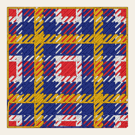 | 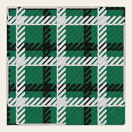 | 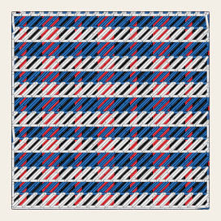 |
<!-- /shot -->

## The sett

The sett is the `tartan` setting, as Ink/Stitch's tartan editor saves it in an SVG file: an object of
JSON. Its `palette` lists the stripes in order, each a colour in brackets and then a width in millimetres:

```json
{"palette": "(#ed171f)/4 (#f0f0f0)1.5 (#0e1f7c)3 (#e8a900)/2", "symmetry": true, "scale": 100, "rotate": 0, "offset_x": 0, "offset_y": 0, "min_stripe_width": 1}
```

- A colour is `#` and 6 or 3 hexadecimal digits, or a colour name of SVG such as `navy`.
- A `?` before the width leaves the stripe unsewn, and the fabric shows there. A `*` sews it in the colour
  of the stripe before it.
- A `|` parts the warp's stripes from the weft's. Without one, the weft is the warp.
- With `symmetry` on, the sett is mirrored at its first and last stripes, the ones Ink/Stitch's editor marks
  with a slash, and each of those is sewn once. Off, the sett repeats.
- `scale` scales every width, in percent. `rotate` turns the sett, in degrees clockwise as the canvas shows
  it, and `offset_x` and `offset_y` move it, in millimetres.
- A stripe no wider than `min_stripe_width` is sewn as a run along its middle ([below](#runs)).

Each setting the object leaves out takes the value Ink/Stitch's editor starts from. A colour that can't be
read leaves its stripe unsewn, as in Ink/Stitch, and `SC-W0328` names it. A sett that can't be read skips
the element, and `SC-E0323` says why. A `palette` can also be a threadcount ([below](#colour-letters)). A
tartan fill without a sett sews Ink/Stitch's default one: stripes 5 mm wide of a thread almost black, with
5 mm left unsewn between them. `SC-W0325` says so. In VectorCraft, a filter writes the sett for you
([below](#in-vectorcraft)).

## Colour letters

A sett can be written as a threadcount, as the Scottish Register of Tartans writes its setts. Each stripe
is its colour's letters followed by its count of threads, such as `B/24 W4 B24 R2 K24 G/24`. Each
thread is 0.5 mm wide, as Ink/Stitch's fill reads it, and the slashes mark the stripes the sett is mirrored
at. `B` is blue, `W` white, `R` red, `K` black and `G` green, and a light or dark shade adds `L` or `D`
before the letter: `DG` is dark green. Each letter stands for one of the shades the register publishes, the
one Ink/Stitch sews for it. A `?` before a count leaves the stripe unsewn, and a `*` sews it in the colour
before it. Letters the register uses for no colour leave their stripe unsewn, and `SC-W0328` names them.

The register's own search gives a threadcount with a palette, which reads as it is pasted, its lines kept:

```text
Threadcount:
K6R20K2Y4W2DG16

Pallet:
K=101010BLACK;R=C80000RED;Y=E8C000YELLOW;W=FFFFFFWHITE;DG=004028DARK GREEN;
```

Each letter then takes the palette's colour.

<!-- shot: tartan-codes -->
| B/24 W4 B24 R2 K24 G/24 | ...DG8 K2 DG8 Y2... | The register's threadcount |
|:-:|:-:|:-:|
| 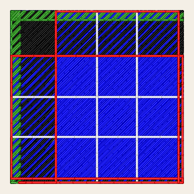 | 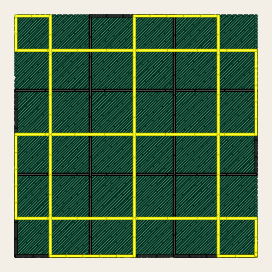 | 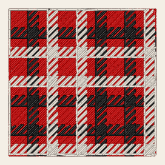 |
<!-- /shot -->

## Rows

The rows run across the stripes at `tartan_angle`, -45° by default, so that they slant across the warp and
the weft alike. They lie `row_spacing_mm` apart. Their needle points lie the longest stitch apart
(`max_stitch_length_mm`), and each row's are moved on from the row before's by `staggers`, as a tatami
fill's are. `rows_per_thread` rows go to the warp and then as many to the weft, over and over. It is 2 by
default, which weaves a twill 2 by 2.
More rows to a thread weave a coarser twill. In each stripe, a colour's rows are joined along the stripe's
edges into one zigzag, which the outline cuts.

## Runs

A stripe no wider than `min_stripe_width` is too narrow for rows. It is sewn as a run along its middle in
its own thread, after every colour's rows, and the stripes beside it share its width. A run along the warp
sews in stitches no longer than `running_stitch_length_mm`, and one along the weft in stitches no longer
than `max_stitch_length_mm`, as Ink/Stitch sews them. `bean_stitch_repeats` sews each stitch of a run back
and forth, for a bolder line. From one run to the next the needle follows the outline, in the run's colour.

<!-- shot: tartan-runs -->
| Stripes of 0.5 and 0.8 mm as runs | Turned 30°, at 150 % | 4 rows per thread |
|:-:|:-:|:-:|
| 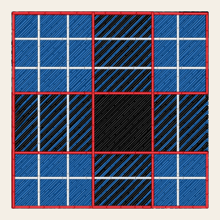 | 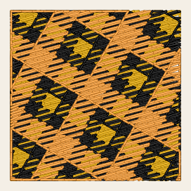 | 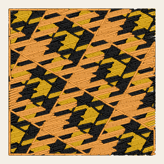 |
<!-- /shot -->

## Colours and their order

Before its colours, each part of the fill sews the tatami fill's underlay in the element's own thread
([tatami fill](tatami-fill.md#underlay)). Then each colour sews its rows in its own thread. The warp's
colours come first, in the order they first appear across its stripes, and then the weft's others. The
runs come last. A stripe in the element's own colour sews in the element's own thread, and the others in
threads of their colours. A colour starts and ends with its rows, and between its rows the needle follows
the outline. With
`stop_at_ending_point` on, every colour starts where the fill starts and ends where it ends instead.
Each colour is a colour block of its own, with a trim after it when the fill's `trim_after` is on. A fill
in several parts sews each part's underlay and colours, and then sorts them by colour, so that each thread
is sewn once.

## Herringbone

With `herringbone_width_mm` above 0 the rows lie in upright bands that wide, as a herringbone twill's ribs do.
Each band's rows slant at 45° to the stripes, the other way from the band before's, whatever `tartan_angle`
is. The stripes then show columns of chevrons. The warp's rows join along their stripes' edges in each band.
The weft's rows run on from band to band along the stripes' edges, and each weft stripe sews as one line where
it crosses the fill. The bands turn with the sett. 4 tartan fonts of Ink/Stitch's library set herringbones 1.6
to 5 mm wide.

<!-- shot: tartan-herringbones -->
| Bands 3 mm wide | Bands 6 mm wide, 3 rows per thread | Bands 3 mm wide, turned 30° |
|:-:|:-:|:-:|
| 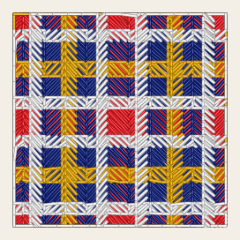 | 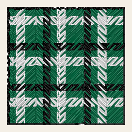 | 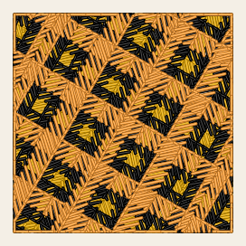 |
<!-- /shot -->

A herringbone's rows cross a stripe in at most the band's width over the cosine of 45°, and wider bands
keep needle points that narrower ones lose. `SC-W0327` says where a band is too narrow for the shortest
stitch.

## In VectorCraft

The StitchCraft Fill dialog offers the tartan fill with its row angle, rows per thread, herringbone width
and where its colours end, and its sett as text in the row Sett, which shows while the fill method is
`tartan_fill`. The row holds the `tartan` setting as Ink/Stitch saves it, so a sett copied from an
Ink/Stitch file can be pasted there. The fill effect needs VectorCraft 0.14 for the row.

To write a sett from its code, select the paths and choose **Object › Plug-ins › StitchCraft Tartan**
(VectorCraft 0.15 and later, with StitchCraft Fill installed). Its dialog takes:

- **Code**: the stripes, as a palette code, `(#0a55a3)/4 (#f0f0f0)1`, or as colour letters with counts of
  threads, `B/24 W4`. The register's threadcount with its palette reads too. Between `...` the sett repeats,
  and otherwise it is mirrored.
- **Thread width**: how wide each thread of a threadcount is, 0.2 mm to start with, as in Ink/Stitch's
  editor.
- **Rotate**, **Scale**, **Move right** and **Move down**: how the sett is laid.
- **Runs up to**: the width up to which a stripe sews as a run, 1 mm to start with.

Each selected path whose StitchCraft effect is the fill effect becomes a tartan fill with that sett, its
other settings as they were. A path without a StitchCraft effect gets the fill effect. The others stay as
they are. A code that can't be read, or that names letters the register doesn't use, leaves the drawing as
it was, and `SC-E0821` says why. So does a selection without a path that can take the sett.

## Test sheet

TS-17B sews 6 tartans 40 mm square for the next machine checkpoint, each in setts of Brother's threads,
the last a herringbone 3 mm wide ([test sheets](../reference/test-sheets.md)). VectorCraft's Test Sheet
filter draws it too.

<!-- shot: testsheet-ts-17b -->
![TS-17B as it will sew: 6 tartans 40 mm square in 2 rows, all woven in rows that slant across their stripes. In the top row, left to right, are stripes of red, white, Prussian blue and gold mirrored at their ends, stripes of green, black and white repeated, and a warp of red and black under a weft of blue and white. Below are blue and black stripes with thin white and red lines along their middles, stripes of gold, black and tangerine turned 30°, and stripes of blue, white, red and black in a herringbone, their rows in narrow upright bands slanting one way and then the other.](../../images/generated/testsheet-ts-17b.png)
<!-- /shot -->

## Parameters

The reference gives each setting's range and default:

- [tartan](../reference/params/tartan.md), the sett, the rows' angle, the rows per thread, the herringbone
  and where each colour ends
- [fill](../reference/params/fill.md), which chooses the fill method
- [tatami fill](../reference/params/tatami.md), the row spacing, staggers, `skip_last`, expanding and the
  underlay
- [path fills](../reference/params/path-fill.md), the runs' bean stitch
- [running stitch](../reference/params/running.md), the stitch length of the runs and the needle's travel
- [the settings every element shares](../reference/params/common.md), the longest stitch among them
