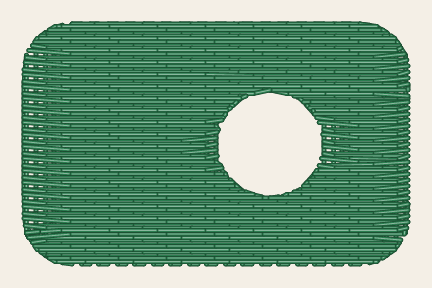
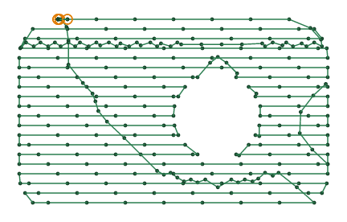
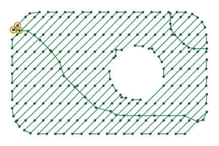
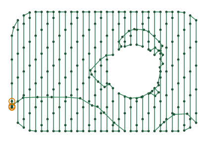
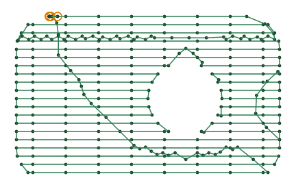
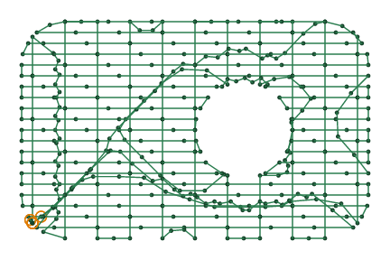

# Tatami fill

<!-- stitch-types: tatami_fill, legacy_fill -->

A tatami fill covers an area with rows of running stitches, sewn back and forth across it. The needle
points of each row lie a little along from the row before's, so that they never line up into furrows. An
area without settings sews as one, unless it is [digitized automatically](automatic.md): a fill's
`fill_method` is `tatami_fill` by default.

The rows go round holes, and each part of the area is filled by itself. Between rows, the needle moves
inside the fill, under rows sewn after it, which hide those stitches (`underpath`). StitchCraft reads a
fill's settings from an SVG file from milestone M8 ([setting parameters](./#setting-parameters)), and the
VectorCraft plug-in sets them today.

The pictures are drawn from `docs/fixtures/fill.svg`, a green patch 32 mm by 20 mm with rounded corners
and a round hole. As it sews by default:

<!-- shot: tatami-fill -->

<!-- /shot -->

## Angle

`angle` turns the rows, in degrees counter-clockwise from horizontal: at 0° they run left to right, at
90° up and down. Fills side by side at the same angle and spacing share their rows, which line up where
they meet. These pictures and the next ones space the rows 1 mm apart, and draw a dot at each needle
point, to show them.

<!-- shot: tatami-angle -->
| 0° | 45° | 90° |
|:-:|:-:|:-:|
|  |  |  |
<!-- /shot -->

## Row spacing

`row_spacing_mm` is how far apart the rows are, 0.25 mm by default. Rows further apart let the fabric
show through, and closer rows cover it but stiffen it. `end_row_spacing_mm` changes the spacing from the
first rows to the last, for a fill that fades.

## Stitch length and staggers

A row sews in stitches as long as `max_stitch_length_mm`, 4 mm by default for a fill. `staggers` is how
many rows the needle points take to come back in line: each row's lie a stitch divided by `staggers`
along from the row before's. With 1, every row's needle points line up, and the fill shows furrows across
its rows.

<!-- shot: tatami-staggers -->
| 4 staggers | 1 stagger |
|:-:|:-:|
|  |  |
<!-- /shot -->

## Underlay

Before its rows, a tatami fill sews an underlay (`fill_underlay`, on by default). It is a sparser fill
square to the top rows, which holds the fabric still and lifts them. `fill_underlay_angle`,
`fill_underlay_row_spacing_mm` and `fill_underlay_inset_mm` change its angle, its spacing and how far
inside the edges it stays.

<!-- shot: tatami-underlay -->
| Underlay | No underlay |
|:-:|:-:|
|  |  |
<!-- /shot -->

## Pull compensation and expanding

As it sews, the thread pulls the fabric in along the rows, and a fill comes out shorter along them than
drawn. `pull_compensation_mm` lengthens each row past the outline at its ends, and `expand_mm` grows
every part of the area before its rows are laid. Automatic digitizing makes up for the pull another
way: each area reaches 0.4 mm under the shapes sewn after it
([automatic digitizing](automatic.md#neighbours)).

## Ink/Stitch's legacy fill

Ink/Stitch's legacy fill is its older fill. It sews each stretch of rows that join on its own, back and
forth, with no stitches inside the fill between stretches. StitchCraft sews a fill set to `legacy_fill`
as a tatami fill without underlay, and says so (`SC-W0314`). Its rows are routed and joined as a tatami
fill's are.
Its flip and reverse settings are kept, and not read (`SC-W0105`). Set `fill_method` to `tatami_fill` to
sew the fill with its underlay.

## Parameters

The reference gives each setting's range and default:

- [fill](../reference/params/fill.md), which chooses the fill method
- [tatami fill](../reference/params/tatami.md), its underlay included
- [pull compensation](../reference/params/pull.md)
- [the settings every element shares](../reference/params/common.md), the stitch length among them
