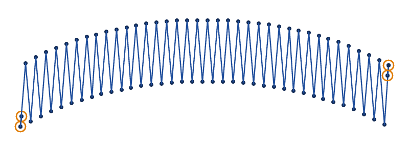
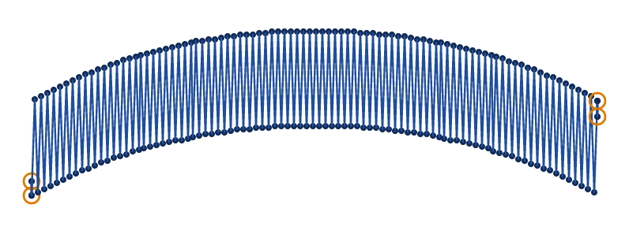
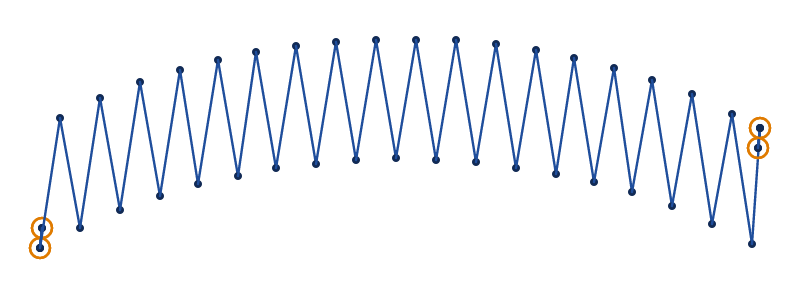
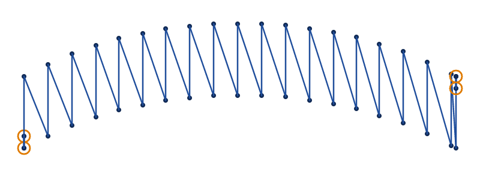

# Zigzag satin

A zigzag satin is a satin column sewn as a zigzag. Every stitch slants across the band, from a point on one
edge to a point on the other half the spacing along, and the next slants back. Turn an element's
`satin_column` on and choose `zigzag` as its `satin_method`. It is drawn, and set up in VectorCraft, as an
[S-stitch](s-stitch.md) is, with `zigzag` in place of `s_stitch`. Its first stitch goes from the first rail
to the second, and `swap_satin_rails` starts it from the other.

The pictures use the S-stitch's band, `docs/fixtures/s-stitch.svg`.

## Spacing

`zigzag_spacing_mm` is how far apart the zigzag's points are along each edge, 0.4 mm by default, as for a
satin column. The 2 edges take turns, half the spacing apart, and the needle crosses the band as often as
a satin column's does. A finer spacing covers the band more closely.

<!-- shot: zigzag-satin-spacing -->
**1 mm**

**0.4 mm**

<!-- /shot -->

## Beside a satin column

A satin column's stitches across go square to the band, and each stitch back slants to the next one
across. Every stitch of a zigzag satin slants, half as far along the band as a satin column's stitch back.

<!-- shot: zigzag-satin-beside-satin -->
**Zigzag satin**

**Satin column**

<!-- /shot -->

## Split stitches

With `max_stitch_length_mm` set, a stitch longer than it is split, as a satin column's stitches are, and
`split_method` says where the splits go. By default each stitch splits into its own fewest equal parts,
where a satin column's stitch back splits into as many as the stitch across before it, as in Ink/Stitch.

## Underlays

A zigzag satin sews a satin column's underlays. Its contour underlay stops where the zigzag's points stop
on each edge, so that it stays under the stitches, as Ink/Stitch's does. After an odd centre walk
Ink/Stitch's stops elsewhere, as the [`contour_underlay`](../reference/params/satin.md#contour_underlay)
reference says.

## Leaning and long stitches

A zigzag satin gives the 2 warnings of every satin method, which the
[S-stitch page](s-stitch.md#leaning-and-long-stitches) describes. `SC-W0208` measures how the rails pair
up, where a satin column's stitches across would go. The slant every zigzag stitch has by design, the
more the wider the spacing and the narrower the band, is left out of it.

## Parameters

Every satin column setting applies to a zigzag satin too, its underlays, compensation and random variation
included. The reference gives each one's range and default:

- [satin column](../reference/params/satin.md)
- [the settings every element shares](../reference/params/common.md)
