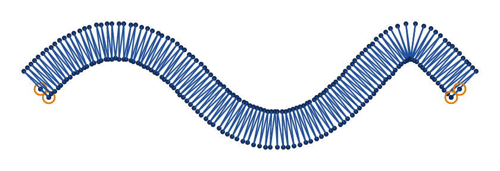
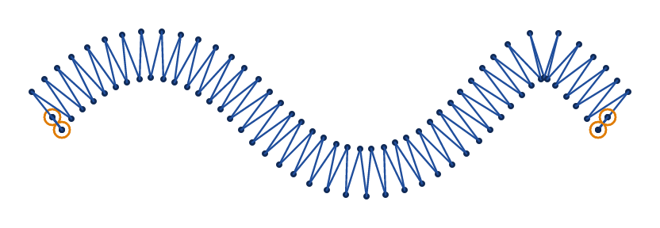
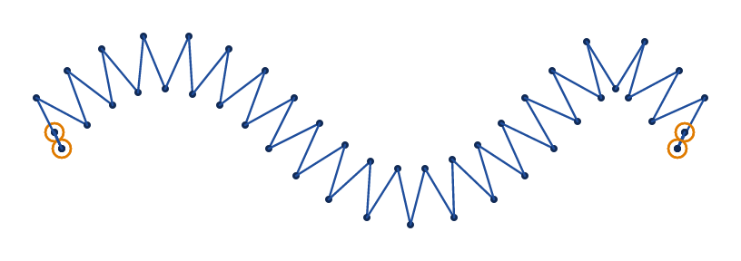
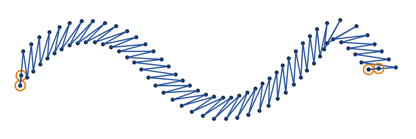
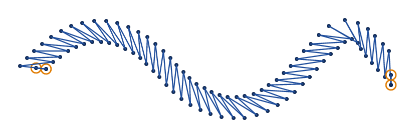

# Zigzag stroke

A zigzag stroke crosses a path from side to side and back, as wide as the stroke's line. Set an element's
`stroke_method` to `zigzag_stitch` for it. Use it for a light border, a couched look, or a stem too thin
for a satin column.

In VectorCraft, set the StitchCraft Stroke effect's `stroke_method` to `zigzag_stitch`, and `stitch export`
sews it. VectorCraft's live effect shows the object as it is drawn, as wide as the zigzag, since VectorCraft
does not tell a plug-in a stroke's width. `stitch plan` reads Ink/Stitch's settings from SVG files from
milestone M8 ([setting parameters](README.md#setting-parameters)).

The pictures are drawn as the [running stitch's](running.md) are, from `docs/fixtures/zigzag.svg`, a wave
drawn 3 mm wide.

## Spacing

`zigzag_spacing_mm` is how far it is along the path from one stitch to the next that crosses the same
way, a zig and a zag together, 0.4 mm by default. The needle points are spread evenly along the path, in
a whole number of zigs and zags, so the zigzag starts and ends on the same side.

<!-- shot: zigzag-spacing -->
**0.4 mm**

**1 mm**

**2 mm**

<!-- /shot -->

Ink/Stitch takes a list of spacings and sews the first, and so does StitchCraft.

## Width and pull compensation

The zigzag is as wide as the stroke's line. Thread pulls the fabric in along each stitch, and a zigzag
sews narrower than it is drawn. `stroke_pull_compensation_mm` takes each side further out by its value.
One value widens both sides. With 2, the first is for the left of the way the path goes and the second
for its right. A negative value makes the zigzag narrower.

## Angle

`zigzag_angle` turns every stitch away from square to the path, from −89° to 89°. A positive angle turns
the stitches clockwise as the drawing shows them. On a curve the turned stitches point like the spokes
of a wheel.

<!-- shot: zigzag-angle -->
**0°**

**45°**

**−45°**

<!-- /shot -->

## Repeats and bean stitch

`repeats` sews the zigzag more than once, every other time backwards, and `bean_stitch_repeats` sews each
stitch more than once, as for a [running stitch](running.md#bean-stitch-and-repeats).

## A closed path

A path that ends where it starts ends its zigzag on its first needle point, and the line closes without a
gap.

## The shortest stitch

Across a zigzag much narrower than the shortest stitch the machine sews well, its stitches are too short,
and StitchCraft leaves their needle points out when it finishes the plan (`SC-I0504`). A part of the path
that is one point is left out, and `SC-W0401` names it.

## Parameters

The reference lists each parameter with its range and default:

- [zigzag stroke](../reference/params/zigzag-stroke.md)
- [repeats and bean stitch](../reference/params/repeat.md)
- [the stroke method](../reference/params/stroke.md)
