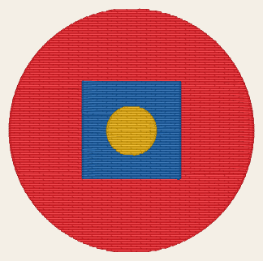

# From a picture to a machine file

A picture of a few flat colours, such as a badge or a logo, becomes a machine file without a setting on any
of its shapes. VectorCraft traces the picture in your machine's threads, and StitchCraft chooses the stitches
of each traced shape by its width ([image to embroidery](../../design/image-to-embroidery.md)).

## You need

- StitchCraft's `stitch` command ([install](../install.md)).
- VectorCraft, for its Image Trace.
- A picture with a few flat colours, such as a PNG file, that fits your hoop once placed.

## 1. Write your machine's threads

```console
{{#include ../reference/generated/palette.txt}}
```

`stitch palette` writes your machine's threads as a GIMP palette, which VectorCraft loads as a swatch
library. Each colour is a thread's own, named as the machine names it. It writes the reference machine's
threads, the Brother PE800's, unless `--profile` names another machine (`stitch profiles` lists them).

## 2. Trace the picture in those threads

In VectorCraft:

1. Load the threads with **Window › Swatch Libraries › Other Library…**, and open `threads.gpl`.
2. Place the picture with **File › Place…**.
3. With the picture selected, open the **Image Trace** panel. Set **Mode** to Color, **Palette** to Document
   Library and **Library** to the threads. **Colors** is how many colours the picture has, its background
   included. With **Method** set to Abutting, the shapes share their edges. Then press **Trace**.
4. Keep the traced shapes, without the picture, with **Object › Image Trace › Expand**.
5. Save the document, here as `traced-badge.vectorcraft`.

Each traced shape is filled in one of your threads. Leave the shapes without StitchCraft's Fill, Stroke and
Satin effects: StitchCraft chooses the stitches of a shape without one, in a VectorCraft document and in
an SVG file planned with `--auto` ([below](#in-vectorcraft-the-auto-effect)).

## 3. Digitize it

```console
{{#include ../reference/generated/plan-traced-badge.txt}}
```

`--auto` digitizes each shape without settings by its width (`SC-I0901`). A line runs, a band as wide as a
satin column sews as satin columns, and a broader area sews as a tatami fill. The white round the badge was
traced lowest, and covers the whole picture. It is the picture's background, the fabric's own colour, and is
left out (`SC-W0906`). The red disc and the blue square are broader than a satin column, and each is
filled whole under the shape in its hole, which sews on top (`SC-I0908`). Each is then cut away under that
shape, a little inside its edge (`SC-I0904` says how far, `auto_overlap_mm`), so that no fabric shows where they meet once the thread pulls
in, and nothing sews twice. A shape drawn in straight strokes, as a block letter or a logo's bars are,
sews a satin column along each stroke, with its stitches square to the stroke. Where 2 strokes meet, one
runs through and the other stops against it, as an embroidery font's letters do. A curved stroke, as a C's,
sews along the shape's middle. The example plans
`traced-badge.svg`, a badge drawn as Image Trace traces one, and a document that VectorCraft saved plans the
same way.

Each notice about one shape names it, such as "Fill 1, Red" ([find a shape by its
name](../how-to/find-a-shape.md)), and `SC-I0912` says which rule chose its stitches. A base layer sews
first, under the whole design, in the thread `SC-I0909` names. It holds the fabric still, so that the shapes on it sew no underlay of their own.
Its hint says how to sew the design without it.

`shares` lists each thread once, in the order the machine is first threaded with it: the stitches it sews,
underlay included, their share of the design's stitches and how many times you thread it. A machine with
one needle is rethreaded by hand for each thread, so look here for a thread that sews little before you
sew. The badge's gold disc sews 184 stitches, 5.4 % of it. What to do about such a thread is yours to
decide: StitchCraft lists the shares and chooses nothing. A report (`--report`) has the same list under
`shares`.

<!-- shot: traced-badge -->

<!-- /shot -->

### In VectorCraft, the Auto effect

VectorCraft's exporters digitize the traced shapes automatically, with the rules' defaults. To change their
settings, select the traced group and choose **Effect › Plug-ins › StitchCraft Auto**. Its dialog has the
settings of the rules in sections named **Stitches by shape**, **Neighbours**, where **Overlap** is how far a
shape is cut away under the next, and **Base layer**. Each starts at its default, and the button beside
it opens its help ([reference](../reference/params/auto.md)). The rules' bounds, such as the widest satin
column and the smallest area sewn, aren't in the dialog: `stitch plan --set` sets them. **Preview**, in a
section of its own, chooses how much of the stitches the canvas shows: auto, exact or outline. The
**Preview** checkbox below it is VectorCraft's, and shows the effect on the canvas while the dialog is open.

<!-- shot: vectorcraft-auto-dialog -->
![The StitchCraft Auto dialog in VectorCraft. The settings of automatic digitizing's rules are in sections named Stitches by shape, from Stitch to Outline round fills, Neighbours, from Overlap to Leave out the background, and Base layer. A section Preview comes last, with its drop-down at auto. Each row has a label, a field with its unit, a drop-down or a checkbox, and a button that opens the setting's help page. Under them are VectorCraft's Preview checkbox, checked, and the Cancel and OK buttons.](../../images/generated/vectorcraft-auto-dialog.png)
<!-- /shot -->

Each traced shape then shows the stitches StitchCraft chooses for it, as far as VectorCraft lets a live
effect work them out: a fill's top rows, and a column's or a line's stitches. A shape that needs more,
such as a letter or a ring, shows its outline instead, and the machine file has every stitch whichever
shows. A filled shape is drawn solid in its own colour either way, as thread will cover it. Zoom in to see
the hairline gaps that mark its rows or stitches. The effect keeps its settings with the document, which **File › Export › Export As** and `stitch export`
sew by, with **Digitize automatically** on or off and with `--no-auto` too
([how](../how-to/embroider-a-vectorcraft-design.md)). VectorCraft stops the export of a large traced
picture, a photo for one, and `stitch export` then writes it
([what to do](../how-to/embroider-a-vectorcraft-design.md#when-vectorcraft-stops-the-export)). Trace again and the group is new, without the
effect: apply it after the last trace.

### From the command line

With VectorCraft's command line installed ([install](../install.md#vectorcrafts-command-line)), `stitch`
takes the steps above itself:

```sh
stitch plan badge.png -o badge.pes --traced badge.vectorcraft
```

It traces the picture in your machine's threads with VectorCraft's command line, as you do in steps 1 and
2. Then it digitizes the shapes as `--auto` does. It fits the picture into your hoop unless `--size` gives the
length of its longer side in millimetres, background included. Image Trace keeps at most `--colours` colours,
6 unless you say otherwise. Count the background's colour too: the badge has 3 colours on white, so 4 keeps
any colour between them out. `--fewer-points` sets Image Trace's Paths and Corners to 0, which draw the
shapes with about a third fewer points and fewer jags thread can't show. It is off by default, since it
also changes how many shapes sew, and it rounds the corners of a logo. To trace by hand as `stitch` does with it, set both to 0 under
**Advanced** in the Image Trace panel (section 2, step 3). Image Trace gives a small bright
colour its thread last, so a picture in 6 threads may lose the red of a small flower or the white of a
sunlit wall. `--keep-colour` gives a colour a thread at any `--colours`. Name the thread as `stitch palette`
and the share list name it, in any case (`--keep-colour "dark fuchsia"`). A colour as `#c70156`, or a
pixel of the picture as `X,Y`, counted from its left and top edges, keeps the thread nearest it. Give it once for each colour you keep. `--drop-colour`, read the same way, leaves a
thread out, one you don't have or don't want to rethread for, and its colours take the nearest of the
others. `stitch` then traces the picture twice, so it takes
twice as long, and says so with `SC-W0822` when no part of the picture is nearer a kept thread than the
other threads. `--traced` keeps the document VectorCraft traced, which you can open in
VectorCraft to correct the trace and then digitize as above. Each of its shapes has the name the notices
give it ([find a shape by its name](../how-to/find-a-shape.md)). When `stitch` can't start VectorCraft's command
line, it says so with `SC-E0815`, and you trace the picture in VectorCraft instead. For a photo, `--subject` cuts
the subject out first, so that the background isn't sewn
([cut a photo's subject out](../how-to/cut-out-a-photos-subject.md)).

## 4. Sew it

Load `traced-badge.pes` and sew it as in [your first sew-out](first-sew-out.md#3-load-it-on-the-machine).
Thread each colour as the machine names it, when it stops for it.

## Next

- [Image to embroidery](../../design/image-to-embroidery.md) says how each shape's stitches are chosen, and
  what is done where shapes meet.
- [Fit a design to the hoop](../how-to/fit-the-hoop.md), when the traced picture is larger than your hoop.
