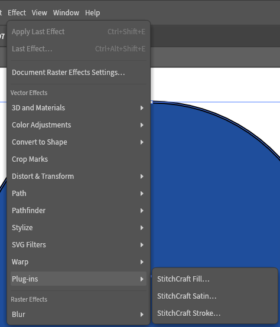
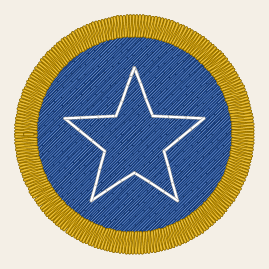

# A patch in VectorCraft

In this tutorial you draw a round patch in VectorCraft and choose how each part of it sews, with the
StitchCraft plug-ins showing the stitches as you go. Then you write the machine file and sew it. The patch
is 30 mm across. It has a blue disc of fill, with a white star of running stitch on it, inside a gold
satin border.

## You need

- VectorCraft, in a version the [compatibility page](../reference/compatibility.md) lists, with the
  StitchCraft plug-ins [installed](../install.md#the-vectorcraft-plug-ins).
- StitchCraft's command line, [installed](../install.md).
- To sew it: the machine and materials of [your first sew-out](first-sew-out.md#you-need).

Sizes here are in points, VectorCraft's own unit: 72 points make an inch, and about 2.8 a millimetre. A
field reads a size typed with its unit, such as `80 pt`, whichever unit it shows.

## 1. Draw the disc and fill it

Choose **File › New**, and make the document 108 pt wide and 108 pt high. Choose the Ellipse tool and
click near the artboard's top left corner. In the Ellipse dialog, make the circle 80 pt wide and 80 pt
high. Give it a blue fill and no stroke. A fill sews in the colour of its object's fill.

With the circle selected, choose **Effect › Plug-ins › StitchCraft Fill**:

<!-- shot: vectorcraft-plugins-menu -->

<!-- /shot -->

The dialog holds Ink/Stitch's [settings for a fill](../reference/params/fill.md), each under its
Ink/Stitch name. Set **Angle** to 45, and choose **OK**. If the dialog runs off your screen, see
[below](#dialogs-taller-than-the-screen).

<details>
<summary>The whole StitchCraft Fill dialog</summary>

<!-- shot: vectorcraft-fill-dialog -->

<!-- /shot -->

</details>

The circle now shows the rows the fill sews, at 45 degrees. VectorCraft lets a plug-in do only so much
work for a preview, and a larger fill, such as a disc more than about 30 mm across, shows its outline
instead of its rows. `stitch export --preview` shows every stitch, whatever the size.

## 2. Draw the star

Choose the Star tool and click in the middle of the disc. Make **Radius 1** 26 pt, **Radius 2** 11 pt and
**Points** 5. Give the star no fill and a white stroke. A line sews in the colour of its object's stroke.
Choose **Effect › Plug-ins › StitchCraft Stroke**, and **OK**. Its settings sew the line in running
stitch, 2.5 mm a stitch.

<details>
<summary>The whole StitchCraft Stroke dialog</summary>

<!-- shot: vectorcraft-stroke-dialog -->

<!-- /shot -->

</details>

## 3. Draw the border

A satin column is drawn as its 2 edges, its rails, joined into one compound path ([satin columns in
VectorCraft](../how-to/vectorcraft-columns-and-presets.md)). Lock the disc and the star first, and Select
All then takes only the rails: choose **Select › All**, then **Object › Lock › Selection**.

With the Ellipse tool, draw 2 more circles, one 84 pt across and one 70 pt across. Choose **Select › All**,
then **Object › Align › Horizontal Align Center** and **Object › Align › Vertical Align Center**. Join the
circles with **Object › Compound Path › Make**. Give the compound path no fill and a gold stroke, and
choose **Effect › Plug-ins › StitchCraft Satin**, then **OK**.

<details>
<summary>The whole StitchCraft Satin dialog</summary>

<!-- shot: vectorcraft-satin-dialog -->

<!-- /shot -->

</details>

## 4. Centre it

Choose **Object › Unlock All** and **Select › All**. Align everything again with **Object › Align ›
Horizontal Align Center**, then **Vertical Align Center**. The patch is done, and VectorCraft shows the
stitches the plug-ins preview:

<!-- shot: vectorcraft-patch -->

<!-- /shot -->

The objects sew in the order they were drawn. The disc sews first and the star next, and the border sews
last, over the edges of both.

## 5. Write the machine file

Save the document as `round-patch.vectorcraft`, and run `stitch export` on it:

```console
{{#include ../reference/generated/export-round-patch.txt}}
```

`round-patch.png` shows what the machine will sew:

<!-- shot: vectorcraft-patch-sewn -->

<!-- /shot -->

## 6. Sew it

Load `round-patch.pes` and sew it as in [your first sew-out](first-sew-out.md#3-load-it-on-the-machine).
Thread blue first, white when the machine stops, and gold when it stops again.

## Dialogs taller than the screen

VectorCraft doesn't scroll a plug-in's dialog, and the fill's and the satin's are taller than most screens.
Their first rows, or the OK button, can be out of sight. Make VectorCraft's window as tall as the screen
allows, and click a field you can see. Tab and Shift+Tab move to the others, and Enter applies the dialog.

## Next

[Embroider a VectorCraft design](../how-to/embroider-a-vectorcraft-design.md) shows how to leave objects
out and mark where a shape starts and ends. It also explains what `stitch export` says.
